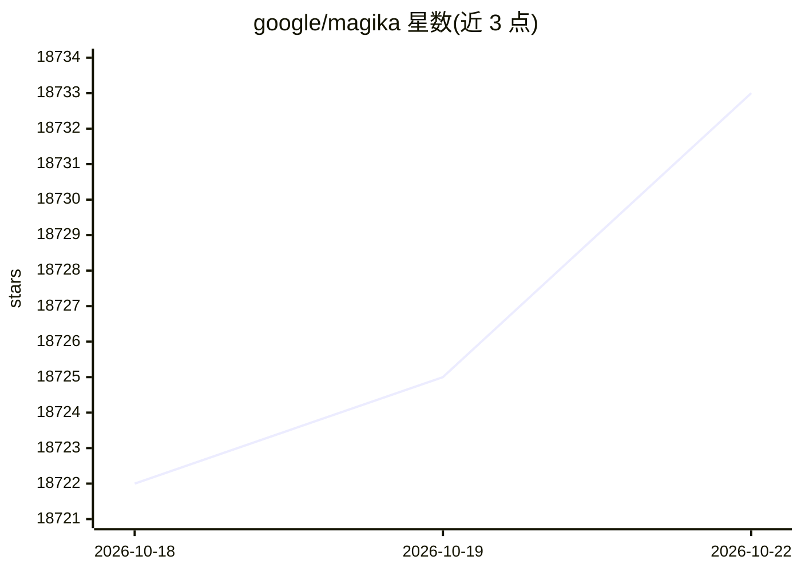

# google/magika

⭐ 18,739 · Rust · Apache-2.0 · 推送 2026-10-22 · [GitHub](https://github.com/google/magika) · [官网](https://securityresearch.google/magika/) · 组织维护

**给开发者与安全场景用的 AI 文件类型检测工具**

基于深度学习的文件内容类型检测工具：模型体积约数 MB，可在单 CPU 上毫秒级完成识别，支持 200+ 内容类型（含二进制与文本），训练与评估数据集约 1 亿样本。提供 Rust 编写的命令行工具、Python API，以及 Rust、JavaScript/TypeScript（实验性 npm 包）和 Go（开发中）绑定；支持递归扫描目录、按内容类型的阈值系统与多种预测模式（high-confidence/medium-confidence/best-guess）。README 注明非 Google 官方项目。

## 筛选速览

| 维度 | 判定 | 备注 |
|---|---|---|
| AI 角色 | `ai-native` | 本体是模型或模型工具 |
| 许可风险 | `permissive` | Apache-2.0 |
| 部署形态 | `library` | 以包/库形式分发 |
| 模型依赖 | — | README 未给出锁定关系 |
| 硬件要求 | — | 无带数字的原话,不猜 |
| 安装摩擦 | `low` | 无编译、无系统依赖或容器化 |
| 成熟度 | — | 结构信号不足 |

## 动量与使用信号

- 维护:`active` — 距上次 push 2.8 天,年发版 6,51 位贡献者
- 涨星:近 1 天 **+0**(自 20261016 起算)
- 安装:pypi 包 `magika` 月下载 15,571,408
- 平台:MACOS / LINUX · 协议:—

## 能力要点

- CLI、Python API 与 Rust/JS/Go 多语言绑定
- 200+ 内容类型，~100M 样本训练评估
- 单 CPU 每文件推理约 5ms，近恒定耗时与文件大小无关
- 按内容类型阈值与多种预测模式控制误判容忍度

## 适用场景

- 安全扫描前识别上传文件的真实类型
- 批量递归扫描目录做内容类型归类
- 在浏览器或 Node 环境中做文件类型检测

## 场景标签

`网络安全` · 领域:学习与行业

## 证据(README 行号)

> L16: Magika is a novel AI-powered file type detection tool that relies on the recent advance of deep learning to provide
> L28: - Available as a command line tool written in Rust, a Python API, and additional bindings for Rust, JavaScript/Type

## 星数曲线

2026-10-18 18,722 → 2026-10-22 18,733（+11）

---
*卡片 v1 · prompt 1.4 · 生成 2026-10-18 · 置信度 high · 依据 README sha `84a412b0fbbd` · [字段定义](../../DATASET.md)*
