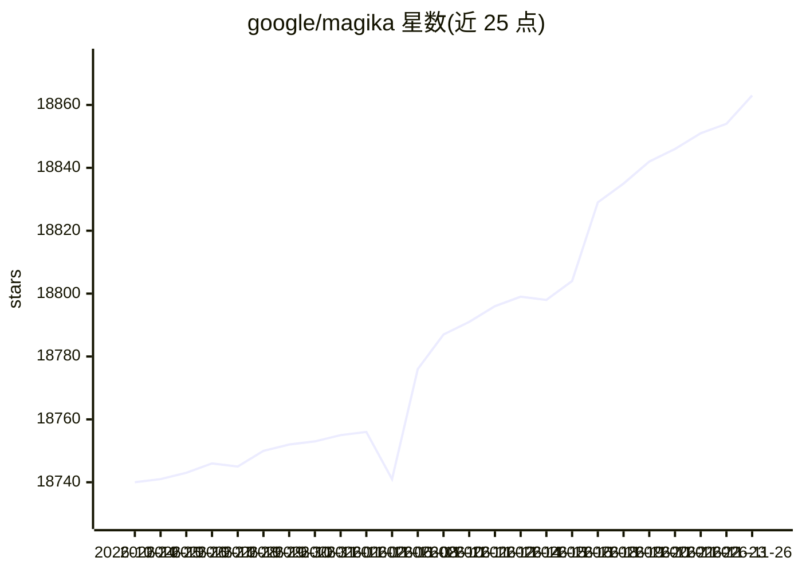

# google/magika

⭐ 18,863 · Rust · Apache-2.0 · 推送 2026-11-24 · [GitHub](https://github.com/google/magika) · [官网](https://securityresearch.google/magika/) · 组织维护

**给开发者用的 AI 文件类型检测工具**

基于深度学习的文件内容类型检测工具，提供 Rust 编写的 CLI、Python API，以及 Rust、JavaScript/TypeScript、Go 绑定。底层为几 MB 的自训练模型，2.0 候选版改用纯 Rust 运行时，支持 Metal/CUDA GPU 加速与并行批处理，并组合 YARA 规则与原生格式解析器。在约 1 亿样本、200+（2.0 为 400+）内容类型上训练，单 CPU 推理约 5ms/文件。Apache 2.0 许可，非官方 Google 项目。

## 筛选速览

| 维度 | 判定 | 备注 |
|---|---|---|
| AI 角色 | `ai-native` | 本体是模型或模型工具 |
| 许可风险 | `permissive` | Apache-2.0 |
| 部署形态 | `library` | 以包/库形式分发 |
| 模型依赖 | — | README 未给出锁定关系 |
| 硬件要求 | — | 无带数字的原话,不猜 |
| 安装摩擦 | `medium` | 含编译或系统依赖之一 |
| 成熟度 | `idea` | |

## 动量与使用信号

- 维护:`active` — 距上次 push 2.8 天,年发版 6,51 位贡献者
- 涨星:近 1 天 **+0**(自 20261016 起算)
- 安装:pypi 包 `magika` 月下载 15,571,408
- 平台:MACOS / LINUX · 协议:—

## 能力要点

- 数 MB 模型在单 CPU 上约 5ms 推理，推理时间与文件大小近似无关
- ~100M 样本、200+（2.0 为 400+）内容类型上训练与评估
- CLI/Python/JS(TS)/Go 多语言接口，支持递归目录扫描与批处理
- 按内容类型阈值与预测模式（high-confidence/medium-confidence/best-guess）控制容错

## 适用场景

- 对上传文件做内容类型识别以支撑安全与内容策略扫描
- 递归批量识别目录下数千个文件的类型
- 在浏览器本地运行的网页 demo 中试用文件检测

## 场景标签

 · 领域:开发工具/文件识别

## 证据(README 行号)

> L16: Magika is a novel AI-powered file type detection tool that relies on the recent advance of deep learning to provide
> L44: - Available as a command line tool written in Rust, a Python API, and additional bindings for Rust, JavaScript/Type

## 星数曲线

2026-10-24 18,740 → 2026-11-26 18,863（+123）

---
*卡片 v1 · prompt 1.4 · 生成 2026-11-26 · 置信度 high · 依据 README sha `38a34eadcc5a` · [字段定义](../../DATASET.md)*
