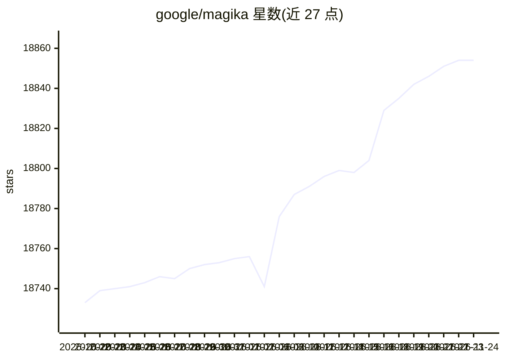

# google/magika

⭐ 18,854 · Rust · Apache-2.0 · 推送 2026-11-20 · [GitHub](https://github.com/google/magika) · [官网](https://securityresearch.google/magika/) · 组织维护

**AI 文件类型检测工具：毫秒级识别 200+ 种内容类型**

基于深度学习的文件类型检测工具，模型仅数 MB，单 CPU 上加载后每文件推理约 5ms。训练与评测数据集约 1 亿样本，覆盖 200+ 种二进制与文本内容类型，测试集平均准确率约 99%。提供 Rust 编写的命令行工具、Python API，以及 Rust、JavaScript/TypeScript、Go 绑定；支持递归目录扫描与批量处理，采用按内容类型的阈值系统与多种预测模式（high-confidence/medium-confidence/best-guess）。在 Google 内部用于 Gmail、Drive、Safe Browsing 的文件分流。

## 筛选速览

| 维度 | 判定 | 备注 |
|---|---|---|
| AI 角色 | `ai-native` | 本体是模型或模型工具 |
| 许可风险 | `permissive` | Apache-2.0 |
| 部署形态 | `library` | 以包/库形式分发 |
| 模型依赖 | — | README 未给出锁定关系 |
| 硬件要求 | — | 无带数字的原话,不猜 |
| 安装摩擦 | `medium` | 含编译或系统依赖之一 |
| 成熟度 | — | 结构信号不足 |

## 动量与使用信号

- 维护:`active` — 距上次 push 2.8 天,年发版 6,51 位贡献者
- 涨星:近 1 天 **+0**(自 20261016 起算)
- 安装:pypi 包 `magika` 月下载 15,571,408
- 平台:MACOS / LINUX · 协议:—

## 能力要点

- 数 MB 模型在单 CPU 上实现约 5ms/文件推理
- 约 1 亿样本训练，覆盖 200+ 内容类型，平均准确率约 99%
- 按内容类型阈值系统与可调预测模式控制误报容忍度
- CLI + Python/Rust/JS/Go 多语言接口

## 适用场景

- 安全扫描前的文件内容类型识别与分流
- 批量递归扫描目录判断文件真实类型
- 在 Python/JS 应用中集成文件类型检测能力

## 场景标签

`网络安全` · 领域:学习与行业

## 证据(README 行号)

> L16: Magika is a novel AI-powered file type detection tool that relies on the recent advance of deep learning to provide
> L39: - Available as a command line tool written in Rust, a Python API, and additional bindings for Rust, JavaScript/Type

## 星数曲线

2026-10-22 18,733 → 2026-11-24 18,854（+121）

---
*卡片 v1 · prompt 1.4 · 生成 2026-11-22 · 置信度 high · 依据 README sha `a4c7ca16e315` · [字段定义](../../DATASET.md)*
