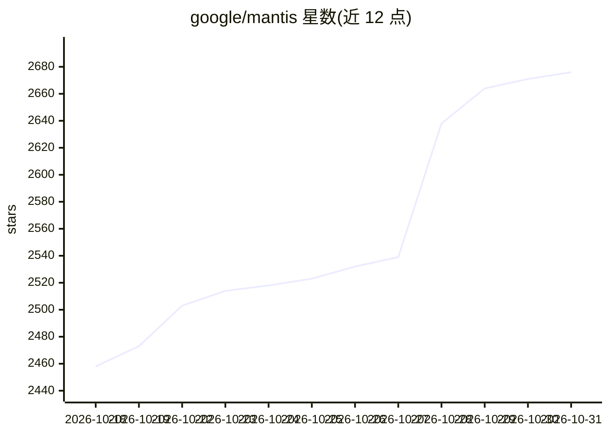

# google/mantis

⭐ 2,676 · Python · Apache-2.0 · 推送 2026-10-30 · [GitHub](https://github.com/google/mantis) · [官网](https://cloud.google.com/) · 组织维护

**供 AI coding agent 自主发现并修补漏洞的技能与参考工具包**

由 Google 维护的模块化、与具体技术栈无关的安全工具包：核心是一组按需加载的 agent 技能（威胁建模、研究、审查、修补、报告）和一个基于 Google ADK 的参考流水线 harness，附 mantis-configure/mantis-launch 配置启动工具与一个尚未端到端验证的 GitHub Action PR 扫描。流程覆盖构建代码语义索引、自动生成威胁模型、研究假设、去重、triage 抗幻觉、漏洞复现、修补与对抗验证、按 rubric 校准严重度。面向安全工程与开发者，需在隔离环境运行；声明非官方支持产品、仅供演示。

## 筛选速览

| 维度 | 判定 | 备注 |
|---|---|---|
| AI 角色 | `ai-ecosystem` | LLM/agent 周边工具 |
| 许可风险 | `permissive` | Apache-2.0 |
| 部署形态 | `None` |  |
| 模型依赖 | — | README 未给出锁定关系 |
| 硬件要求 | — | 无带数字的原话,不猜 |
| 安装摩擦 | `low` | 无编译、无系统依赖或容器化 |
| 成熟度 | `idea` | |

## 能力要点

- 按需加载的安全技能集：从威胁建模到修补与报告
- 基于 Google ADK 的参考 harness，可运行可改编，支持动态生成研究图拓扑
- 漏洞去重、triage 抗幻觉、复现与对抗性修补验证、严重度校准流程
- 提供 mantis-configure/mantis-launch 自动化配置与启动工具

## 适用场景

- 让 AI agent 对代码库做深度安全审查并生成补丁
- 在开发过程中通过 /mantis-advise 技能避免重复历史漏洞
- 按组织自身技术栈改编威胁模型与风险校准流程

## 场景标签

`代码审查` `编码 Agent` · 领域:编码与开发

## 证据(README 行号)

> L26: Mantis is a set of skills along with an ADK reference harness for building
> L31: - `reference/` -- an ADK harness that runs the method as a

## 星数曲线

2026-10-18 2,458 → 2026-10-31 2,676（+218）

---
*卡片 v1 · prompt 1.4 · 生成 2026-10-21 · 置信度 high · 依据 README sha `c9b536313075` · [字段定义](../../DATASET.md)*
