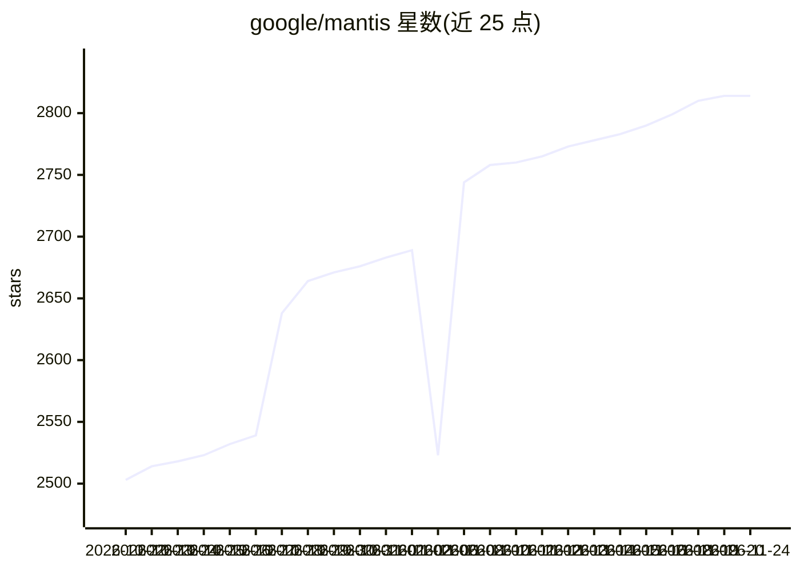

# google/mantis

⭐ 2,814 · Python · Apache-2.0 · 推送 2026-11-22 · [GitHub](https://github.com/google/mantis) · [官网](https://cloud.google.com/) · 组织维护

**给 AI 编码 agent 的漏洞发现、复现与修补工具包**

Mantis 由 skills 方法集与 ADK 参考执行器组成：agent 按需加载从威胁建模、研究、评审到修补与报告的技能，通过流水线扫描仓库——构建 tree-sitter 语义索引、生成威胁模型、分配研究假设、去重与校准发现、复现漏洞（静态分析到沙箱内动态利用）、以对抗循环验证补丁。结果存入 knowledge.db，支持 SARIF 导出与 MCP 侧车接入。要求隔离环境运行，发现需人工复核；GitHub Action 部分声明未经端到端验证。

## 筛选速览

| 维度 | 判定 | 备注 |
|---|---|---|
| AI 角色 | `ai-native` | 本体是模型或模型工具 |
| 许可风险 | `permissive` | Apache-2.0 |
| 部署形态 | `None` |  |
| 模型依赖 | — | README 未给出锁定关系 |
| 硬件要求 | — | 无带数字的原话,不猜 |
| 安装摩擦 | `low` | 无编译、无系统依赖或容器化 |
| 成熟度 | `idea` | |

## 能力要点

- 从威胁建模到补丁验证的完整 agent 流水线（ADK 参考实现）
- tree-sitter 语义索引覆盖 20+ 语法，含固件/RTL 与智能合约
- 支持 SARIF 2.1.0 导出与 MCP 编码 agent 侧车接入
- 知识库 knowledge.db 累积威胁模型与历史发现供 /mantis-advise 查询

## 适用场景

- 在隔离环境中对仓库做深度安全扫描并复现漏洞
- 扫描 PR 中的安全变更（GitHub Action，声明未经验证）
- 开发时通过 MCP 查询历史威胁模型避免重复引入问题

## 场景标签

`网络安全` `多智能体` · 领域:Agent 开发

## 证据(README 行号)

> L26: Mantis is a set of skills along with an ADK reference harness for building
> L128: - Review history of a codebase to look for historical vulnerabilities we do not
> L145: - Patch discovered vulnerabilities, using an adversarial loop to verify the

## 星数曲线

2026-10-22 2,503 → 2026-11-24 2,814（+311）

---
*卡片 v1 · prompt 1.4 · 生成 2026-11-23 · 置信度 high · 依据 README sha `2a31a2f20a46` · [字段定义](../../DATASET.md)*
