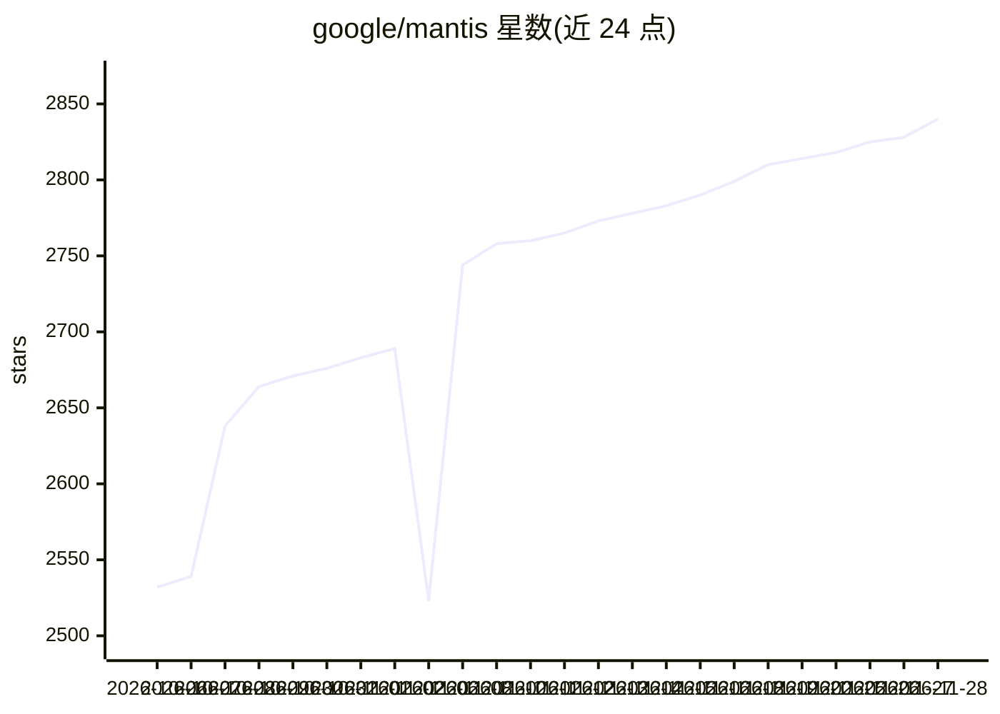

# google/mantis

⭐ 2,840 · Python · Apache-2.0 · 推送 2026-11-27 · [GitHub](https://github.com/google/mantis) · [官网](https://cloud.google.com/) · 组织维护

**给安全团队用的 AI 代理漏洞发现与修补工具包**

Mantis 由技能集与一个 ADK 参考执行器组成，驱动 AI 代理按流水线完成威胁建模、研究、审查、修补与报告：构建 tree-sitter 语义索引（20+ 语法）、自动生成威胁模型与假设、去重并校准发现、复现漏洞、以对抗循环验证修补，结果存入 knowledge.db 并支持 SARIF 导出与 MCP sidecar 接入。依赖 LLM 凭据（Vertex AI/Gemini API/Anthropic/OpenAI），需在隔离环境运行，PR 扫描 GitHub Action 尚未经端到端验证，发现须人工复核。

## 筛选速览

| 维度 | 判定 | 备注 |
|---|---|---|
| AI 角色 | `ai-native` | 本体是模型或模型工具 |
| 许可风险 | `permissive` | Apache-2.0 |
| 部署形态 | `None` |  |
| 模型依赖 | — | README 未给出锁定关系 |
| 硬件要求 | — | 无带数字的原话,不猜 |
| 安装摩擦 | `low` | 无编译、无系统依赖或容器化 |
| 成熟度 | — | 结构信号不足 |

## 能力要点

- 技能按需加载，覆盖威胁建模到修补报告全流程
- 支持 1-100 的 --depth 扫描深度与 token/时间预算护栏
- SARIF 2.1.0 导出与 MCP 服务器接入编程代理
- 覆盖全栈 Web、固件/RTL、智能合约、移动端等仓库类型

## 适用场景

- 在隔离环境中对代码仓库做深度安全扫描并复现漏洞
- 自动修补已发现的漏洞并用对抗循环验证修复效果
- 通过 MCP 让编程代理在开发中查询既有威胁模型与发现

## 场景标签

`多智能体` `网络安全` `代码审查` · 领域:Agent 开发

## 证据(README 行号)

> L26: Mantis is a set of skills along with an ADK reference harness for building
> L128: - Review history of a codebase to look for historical vulnerabilities we do not
> L141: - Reproduce the vulnerability to varying degrees, depending on available

## 星数曲线

2026-10-26 2,532 → 2026-11-28 2,840（+308）

---
*卡片 v1 · prompt 1.4 · 生成 2026-11-28 · 置信度 high · 依据 README sha `baf41116eb9f` · [字段定义](../../DATASET.md)*
