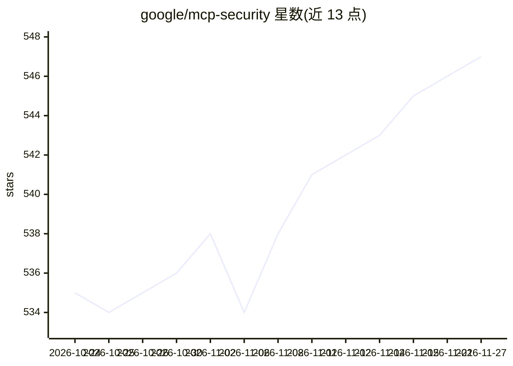

# google/mcp-security

⭐ 547 · Python · Apache-2.0 · 推送 2026-11-20 · [GitHub](https://github.com/google/mcp-security) · 组织维护

**让 MCP 客户端访问 Google 安全产品（SecOps/GTI/SCC）的 MCP 服务器**

包含多个 Model Context Protocol 服务器，使 Claude Desktop、Cline 等 MCP 客户端能访问 Google 的安全产品：Google SecOps（威胁检测/调查/狩猎）、SecOps SOAR（编排自动化响应）、Google Threat Intelligence、Security Command Center。各服务器可独立安装运行，提供远程托管版 SecOps MCP 服务器；使用 Google 认证（ADC/服务账号/gcloud 登录），通过 uv/pip 分发，README 给出各 MCP 客户端的 JSON 配置文件位置与 Windows 路径说明。

## 筛选速览

| 维度 | 判定 | 备注 |
|---|---|---|
| AI 角色 | `ai-ecosystem` | LLM/agent 周边工具 |
| 许可风险 | `permissive` | Apache-2.0 |
| 部署形态 | `library` | 以包/库形式分发 |
| 模型依赖 | — | README 未给出锁定关系 |
| 硬件要求 | — | 无带数字的原话,不猜 |
| 安装摩擦 | `low` | 无编译、无系统依赖或容器化 |
| 成熟度 | — | 结构信号不足 |

## 能力要点

- 5 个可独立启用的 MCP 服务器：SecOps、SOAR、GTI、SCC 及远程托管版
- 支持 Claude Desktop、Cline、Gemini CLI、Google ADK 等 MCP 客户端接入
- 提供 uvx 直接运行与 .env 环境变量文件加载
- Gemini CLI 专用安全技能扩展示例（Triage/Investigate/Hunt）

## 适用场景

- 在 Claude Desktop/Cline 中查询与调查 Chronicle 威胁检测数据
- 通过 AI 客户端执行 SOAR 安全编排与事件响应操作
- 将 Google 威胁情报数据接入 agent 工作流
- 用 Security Command Center 做云安全风险管理查询

## 场景标签

`网络安全` · 领域:学习与行业

## 证据(README 行号)

> L3: This repository contains Model Context Protocol (MCP) servers that enable MCP clients (like Claude Desktop or the cl
> L5: 1. **Remote MCP Server for Google SecOps** - Fully managed, enterprise-ready MCP server (Recommended)

## 星数曲线

2026-10-24 535 → 2026-11-27 547（+12）

---
*卡片 v1 · prompt 1.4 · 生成 2026-11-25 · 置信度 high · 依据 README sha `94ecc0120550` · [字段定义](../../DATASET.md)*
