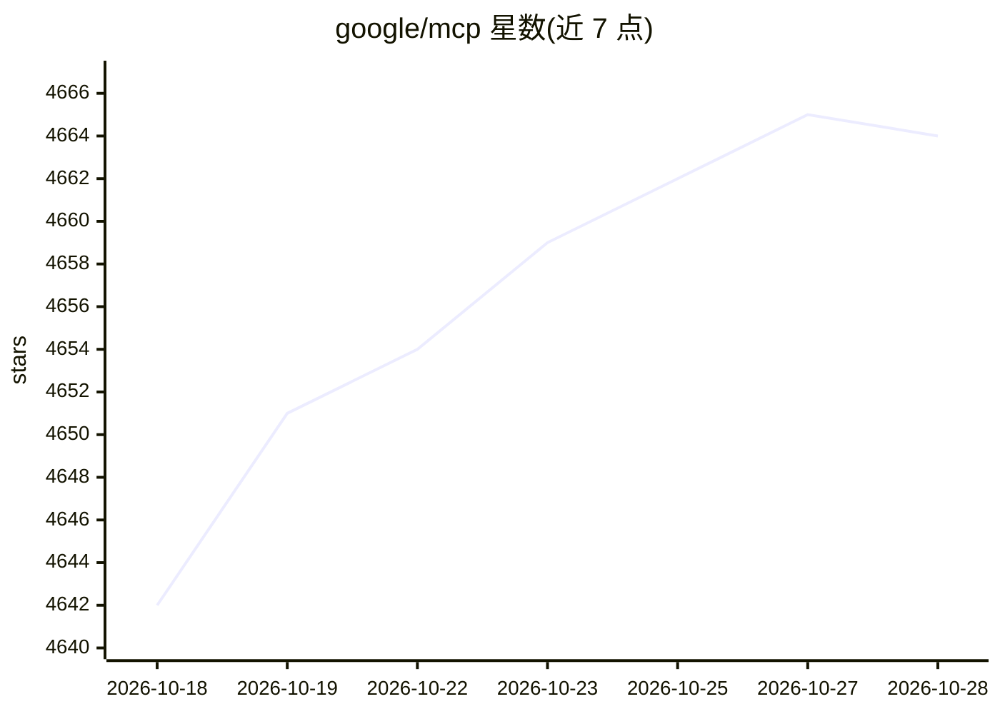

# google/mcp

⭐ 4,668 · Apache-2.0 · 推送 2026-08-17 · [GitHub](https://github.com/google/mcp) · 组织维护

**Google 官方 MCP 服务器清单与部署指南集合**

Google 维护的 Model Context Protocol（MCP）服务器聚合仓库：列出 Google 托管的远程 MCP 服务器（覆盖 BigQuery、Cloud SQL、Spanner、GKE 等产品）与可本地运行或部署到 Google Cloud 的开源 MCP 服务器（如 Google Workspace、Firebase、MCP Toolbox for Databases 等），并提供部署到 Cloud Run 的文档、博客与 Codelab 资源，以及两个示例 agent 应用。README 声明非官方支持产品，仅作演示用途。

## 筛选速览

| 维度 | 判定 | 备注 |
|---|---|---|
| AI 角色 | `ai-knowledge` | 知识聚合/清单类 |
| 许可风险 | `permissive` | Apache-2.0 |
| 部署形态 | `None` |  |
| 模型依赖 | — | README 未给出锁定关系 |
| 硬件要求 | — | 无带数字的原话,不猜 |
| 安装摩擦 | `low` | 无编译、无系统依赖或容器化 |
| 成熟度 | — | 结构信号不足 |

## 能力要点

- 汇总 Google 托管的远程 MCP 服务器（GA 与 public preview）
- 列出可本地运行或部署到 Google Cloud 的开源 MCP 服务器
- 提供 Cloud Run/Apigee 部署文档、博客与 Codelab 资源
- 含两个使用远程 MCP 服务器的示例应用（Launch My Bakery、Allstrides）

## 适用场景

- 查找 Google 各产品的 MCP 服务器端点与接入方式
- 学习如何将 MCP 服务器部署到 Cloud Run 或 GKE
- 参考示例应用构建使用 MCP 的 agent

## 场景标签

`精选清单` `教程课程` · 领域:学习与行业

## 证据(README 行号)

> L3: This repository contains a list of Google's official Model Context Protocol (MCP) servers, guidance on how to deploy
> L9: These remote MCP servers are managed by Google, and are available via endpoint. Below are a few key remote servrs. F

## 星数曲线

2026-10-18 4,642 → 2026-10-28 4,664（+22）

---
*卡片 v1 · prompt 1.4 · 生成 2026-10-20 · 置信度 high · 依据 README sha `cf0ffed8fc73` · [字段定义](../../DATASET.md)*
