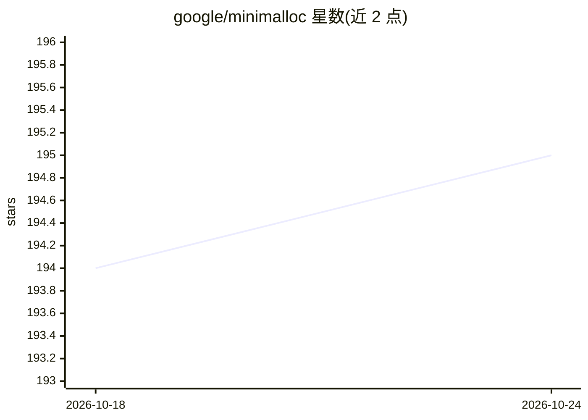

# google/minimalloc

⭐ 195 · C++ · Apache-2.0 · 推送 2026-04-06 · [GitHub](https://github.com/google/minimalloc) · 组织维护

**面向硬件加速 ML 编译器的静态内存分配求解器**

Google 发布的 ASPLOS 2023 论文配套源码：求解深度学习编译器中的静态内存分配问题，即把一组具有预定义生命周期的 buffer 映射到全局内存偏移。核心机制包括限定在代数格上的规范解集合以缩小搜索空间并保持 soundness 与完备性、空间推理提前回溯、支配解消除。提供 C++ 命令行工具（CMake 构建）与 Python 绑定（pip 安装），输入输出为 CSV。声明非 Google 官方支持产品。

## 筛选速览

| 维度 | 判定 | 备注 |
|---|---|---|
| AI 角色 | `ai-ecosystem` | LLM/agent 周边工具 |
| 许可风险 | `permissive` | Apache-2.0 |
| 部署形态 | `library` | 以包/库形式分发 |
| 模型依赖 | — | README 未给出锁定关系 |
| 硬件要求 | — | 无带数字的原话,不猜 |
| 安装摩擦 | `medium` | 含编译或系统依赖之一 |
| 成熟度 | — | 结构信号不足 |

## 能力要点

- 基于规范解（canonical solutions）格结构的静态内存分配搜索算法
- 空间推理实现提前回溯，支配解检测与消除机制
- 提供 C++ CLI 与 Python 绑定（pip 可安装）
- CSV 格式输入输出，输入为 buffer 生命周期区间与大小

## 适用场景

- ML 编译器开发者为 buffer 分配问题寻找最优偏移方案
- 科研人员复现或引用 ASPLOS 2023 论文的分配算法
- 通过 Python 绑定在工具链中集成静态内存分配求解

## 场景标签

 · 领域:编译器/ML 基础设施

## 证据(README 行号)

> L9: An increasing number of deep learning workloads are being supported by *hardware acceleration*. In order to unlock t
> L11: **MiniMalloc** is a state-of-the-art algorithm designed specifically for static memory allocation that uses several

## 星数曲线

2026-10-18 194 → 2026-10-24 195（+1）

---
*卡片 v1 · prompt 1.4 · 生成 2026-10-22 · 置信度 mid · 依据 README sha `51ced383ba6b` · [字段定义](../../DATASET.md)*
