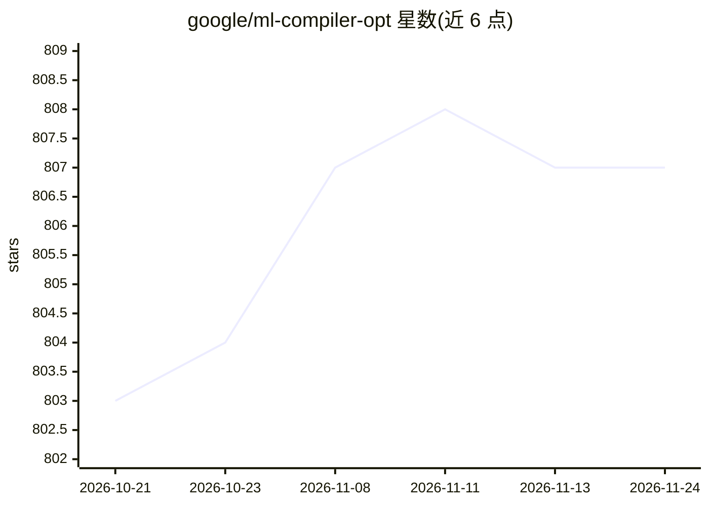

# google/ml-compiler-opt

⭐ 807 · Python · Apache-2.0 · 推送 2026-11-18 · [GitHub](https://github.com/google/ml-compiler-opt) · 组织维护

**LLVM 的 MLGO 机器学习编译优化训练基础设施**

该仓库是 LLVM 中 MLGO 框架的训练基础设施与相关工具：MLGO 将机器学习模型接入 LLVM，替代人工编写的优化启发式，当前支持 inlining-for-size 与 register-allocation-for-performance 两项优化。训练采用 Policy Gradient 算法（Evolution Strategies 在路线图中），本地训练环境要求 Ubuntu 22.04、Python 3.10/3.11 及高性能工作站。预训练模型以 GitHub releases 形式发布，构建 LLVM 时可通过 cmake 标志指定模型路径或自动下载。

## 筛选速览

| 维度 | 判定 | 备注 |
|---|---|---|
| AI 角色 | `ai-ecosystem` | LLM/agent 周边工具 |
| 许可风险 | `permissive` | Apache-2.0 |
| 部署形态 | `self-host` | docker 或自建部署 |
| 模型依赖 | — | README 未给出锁定关系 |
| 硬件要求 | — | 无带数字的原话,不猜 |
| 安装摩擦 | `low` | 无编译、无系统依赖或容器化 |
| 成熟度 | — | 结构信号不足 |

## 能力要点

- 将 LLVM 的 inlining-for-size 与 regalloc 优化启发式替换为机器学习模型
- 提供 Policy Gradient 训练基础设施，Evolution Strategies 在路线图中
- 预训练模型经 GitHub releases 发布，版本号与 LLVM 侧兼容性对应
- LLVM 构建时可用 -DLLVM_INLINER_MODEL_PATH 指定或自动下载模型

## 适用场景

- 从头训练自己的 inlining-for-size 策略模型
- 训练 register-allocation-for-performance 策略
- 下载预训练模型直接用于 LLVM 构建

## 场景标签

`模型训练` `强化学习` · 领域:训练与推理

## 证据(README 行号)

> L3: MLGO is a framework for integrating ML techniques systematically in LLVM. It
> L11: repository contains the training infrastructure and related tools for MLGO.

## 星数曲线

2026-10-21 803 → 2026-11-24 807（+4）

---
*卡片 v1 · prompt 1.4 · 生成 2026-11-24 · 置信度 mid · 依据 README sha `d7823084c485` · [字段定义](../../DATASET.md)*
