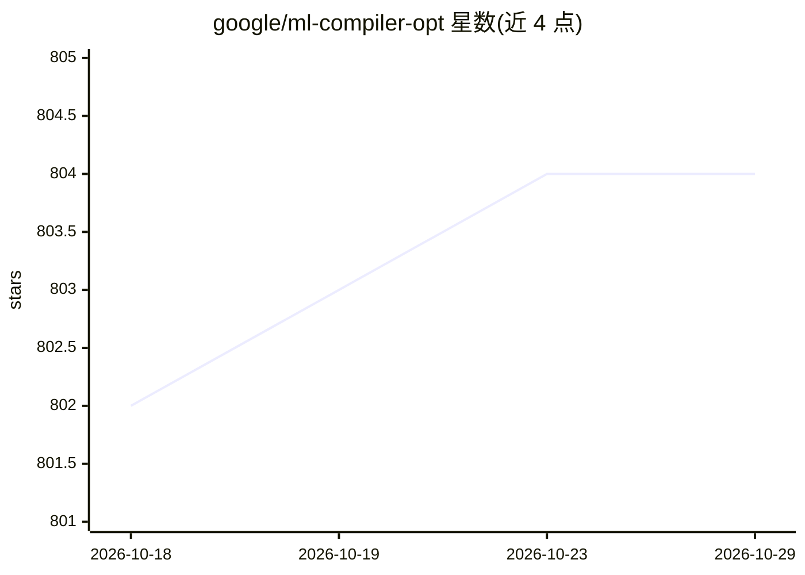

# google/ml-compiler-opt

⭐ 804 · Python · Apache-2.0 · 推送 2026-10-22 · [GitHub](https://github.com/google/ml-compiler-opt) · 组织维护

**面向编译器研究者的 ML 引导 LLVM 优化策略训练框架**

MLGO 是将机器学习系统性集成到 LLVM 的框架：用训练出的模型替换人工编写的优化启发式。编译器组件已合入 LLVM 主仓库，本仓库提供训练基础设施与相关工具，当前支持 inlining-for-size 与 register-allocation-for-performance 两项优化的训练，算法上目前仅支持 Policy Gradient（Evolution Strategies 在路线图中）。训练需基于 ML development-mode 的 clang 构建，推荐高性能工作站（如 96 硬件线程）。另以 GitHub releases 形式发布可直接配合 LLVM 使用的预训练模型。

## 筛选速览

| 维度 | 判定 | 备注 |
|---|---|---|
| AI 角色 | `ai-ecosystem` | LLM/agent 周边工具 |
| 许可风险 | `permissive` | Apache-2.0 |
| 部署形态 | `library` | 以包/库形式分发 |
| 模型依赖 | — | README 未给出锁定关系 |
| 硬件要求 | — | 无带数字的原话,不猜 |
| 安装摩擦 | `medium` | 含编译或系统依赖之一 |
| 成熟度 | — | 结构信号不足 |

## 能力要点

- 用机器学习模型替换 LLVM 人工优化启发式
- 支持 inlining-for-size 与 regalloc-for-performance 两个优化任务的策略训练
- 提供 Policy Gradient 训练与端到端训练演示
- 预训练模型通过 GitHub releases 发布，cmake 可自动下载接入

## 适用场景

- 从零训练自己的 LLVM 内联/寄存器分配优化策略
- 下载预训练模型直接配合 LLVM 构建使用
- 研究强化学习在编译器优化中的应用

## 场景标签

`强化学习` · 领域:训练与推理

## 证据(README 行号)

> L3: MLGO is a framework for integrating ML techniques systematically in LLVM. It
> L4: replaces human-crafted optimization heuristics in LLVM with machine learned
> L11: repository contains the training infrastructure and related tools for MLGO.

## 星数曲线

2026-10-18 802 → 2026-10-29 804（+2）

---
*卡片 v1 · prompt 1.4 · 生成 2026-10-21 · 置信度 mid · 依据 README sha `5f6027234d46` · [字段定义](../../DATASET.md)*
