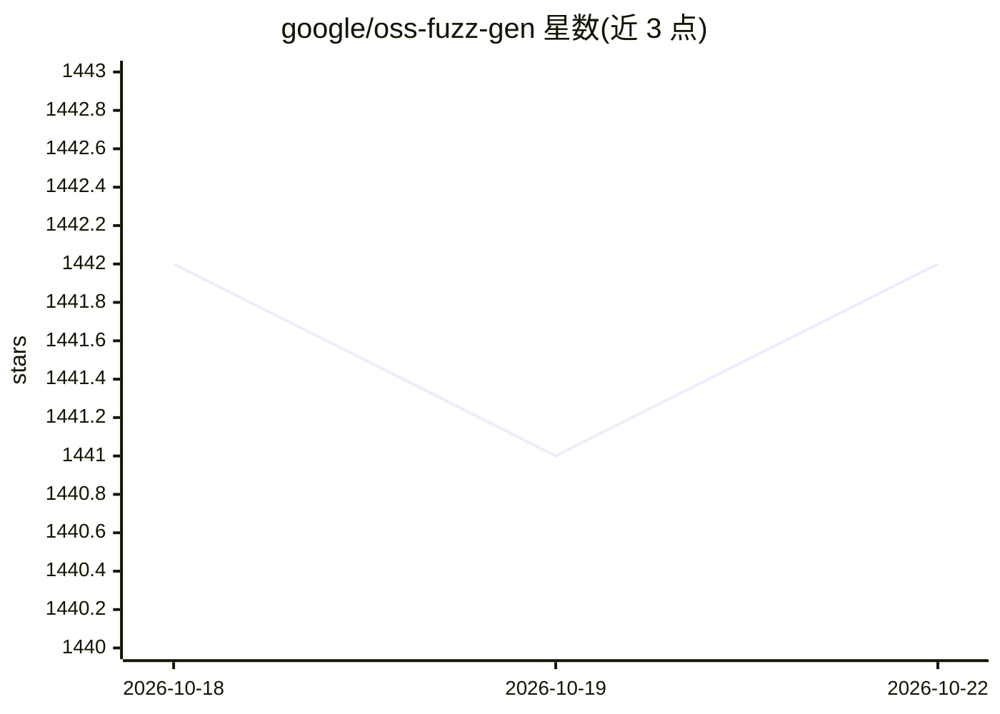

# google/oss-fuzz-gen

⭐ 1,442 · Python · Apache-2.0 · 推送 2026-03-17 · [GitHub](https://github.com/google/oss-fuzz-gen) · 组织维护

**用 LLM 为 C/C++/Java/Python 项目生成并评测 fuzz target 的框架**

Google 维护的模糊测试目标生成框架：调用 Vertex AI、Gemini、OpenAI GPT 系列等多种 LLM，为真实开源项目生成 fuzz target，并经 OSS-Fuzz 平台以可编译性、运行时崩溃、覆盖率和与人工编写 target 的行覆盖差四项指标评测。支持独立 agent 执行与评测，已报告 30 个由自动生成 target 发现的新漏洞（含 OpenSSL CVE-2024-9143），README 未直接给出安装命令，指向外部使用指南。

## 筛选速览

| 维度 | 判定 | 备注 |
|---|---|---|
| AI 角色 | `ai-ecosystem` | LLM/agent 周边工具 |
| 许可风险 | `permissive` | Apache-2.0 |
| 部署形态 | `None` |  |
| 模型依赖 | — | README 未给出锁定关系 |
| 硬件要求 | — | 无带数字的原话,不猜 |
| 安装摩擦 | `low` | 无编译、无系统依赖或容器化 |
| 成熟度 | — | 结构信号不足 |

## 能力要点

- 支持 Vertex AI / Gemini / OpenAI GPT（含 Azure）多系列模型
- 四项指标经 OSS-Fuzz 生产环境评测生成结果
- 可独立执行或评测单个 agent 而非完整实验
- 已报告 30 个新漏洞，含 OpenSSL CVE-2024-9143

## 适用场景

- 为开源 C/C++ 项目自动生成提升覆盖率的 fuzz target
- 对比不同 LLM 在 fuzz target 生成任务上的表现
- 利用生成的 target 发现现有测试无法触及的漏洞

## 场景标签

`模型评测` `网络安全` `代码生成` · 领域:编码与开发

## 证据(README 行号)

> L3: This framework generates fuzz targets for real-world `C`/`C++/Java/Python` projects with
> L4: various Large Language Models (LLM) and benchmarks them via the
> L5: `OSS-Fuzz` platform.

## 星数曲线

2026-10-18 1,442 → 2026-10-22 1,442（+0）

---
*卡片 v1 · prompt 1.4 · 生成 2026-10-21 · 置信度 high · 依据 README sha `a007ac13d9ee` · [字段定义](../../DATASET.md)*
