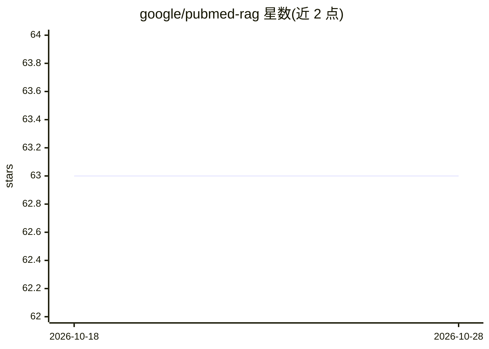

# google/pubmed-rag

⭐ 63 · Jupyter Notebook · Apache-2.0 · 推送 2026-07-27 · [GitHub](https://github.com/google/pubmed-rag) · 个人维护

**基于 BigQuery 向量检索与 Gemini 的医学文献 RAG 分析项目**

将 PubMed Central 开放获取语料（BigQuery 中 240 万篇带预计算嵌入的文章）作为检索源，用 Vertex AI Gemini 模型构建医学文献分析应用。提供三类入口：临床医生用的 Colab 笔记本（Gradio 交互界面，粘贴病例即可抽取疾病与事件并生成分析报告）、数据科学家可定制打分流程的笔记本、工程师可部署的组合式 ADK agent 目录（含两条现成 pipeline 与一键本地运行，可部署到 Vertex AI Agent Engine）。声明非官方 Google 项目，限研究与教育用途，不得用于临床决策。

## 筛选速览

| 维度 | 判定 | 备注 |
|---|---|---|
| AI 角色 | `ai-native` | 本体是模型或模型工具 |
| 许可风险 | `permissive` | Apache-2.0 |
| 部署形态 | `library` | 以包/库形式分发 |
| 模型依赖 | — | README 未给出锁定关系 |
| 硬件要求 | — | 无带数字的原话,不猜 |
| 安装摩擦 | `low` | 无编译、无系统依赖或容器化 |
| 成熟度 | — | 结构信号不足 |

## 能力要点

- 检索 BigQuery 中 240 万篇带预计算嵌入的 PubMed Central 开放获取文章
- Gradio 交互应用：粘贴病例笔记，自动抽取疾病与事件并生成分析报告
- composable ADK agent 目录，两条现成 pipeline，一键本地运行
- 支持部署到 Vertex AI Agent Engine，含 SCImago 期刊影响因子数据

## 适用场景

- 临床医生无代码分析病例相关医学文献
- 数据科学家定制文献打分与分析流程
- 工程师构建并部署医学文献检索 agent

## 场景标签

`RAG` `科研工具` · 领域:知识与检索

## 证据(README 行号)

> L3: Build retrieval-augmented applications over medical literature using Google
> L4: Cloud BigQuery vector search and Vertex AI Gemini models.
> L22: 4. Use the interactive Gradio app to:

## 星数曲线

2026-10-18 63 → 2026-10-28 63（+0）

---
*卡片 v1 · prompt 1.4 · 生成 2026-10-24 · 置信度 mid · 依据 README sha `1e79eb43a6d9` · [字段定义](../../DATASET.md)*
