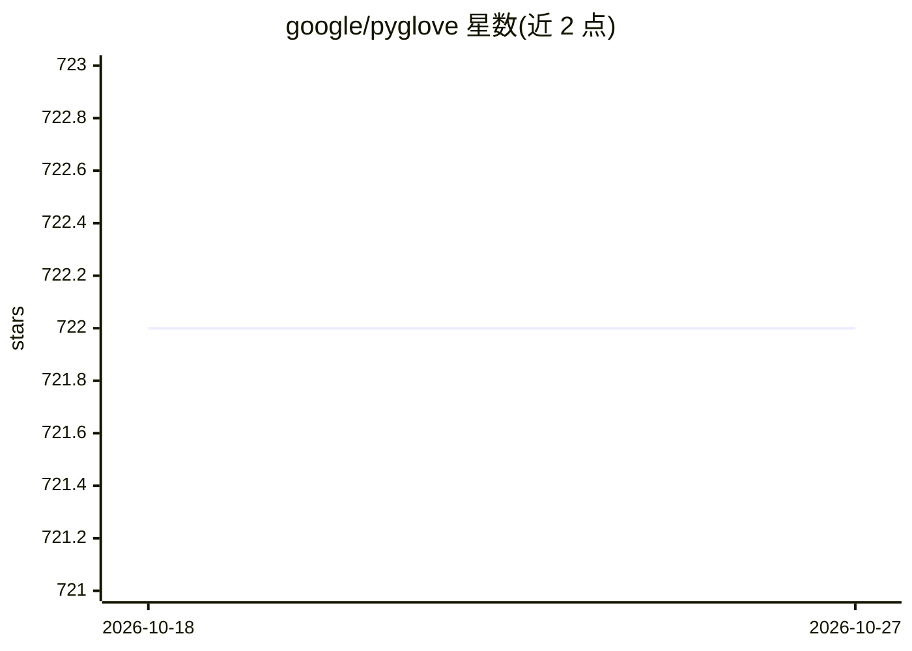

# google/pyglove

⭐ 722 · Python · Apache-2.0 · 推送 2026-10-05 · [GitHub](https://github.com/google/pyglove) · 组织维护

**Python 对象操控库：符号化编程支撑 AutoML 与程序搜索**

通用 Python 对象操控库，引入符号化面向对象编程，提供可变符号对象模型与一组对象操作 API，用于简化元程序编写。核心机制包括：向既有 Python 程序嵌入搜索的 API、定义搜索空间的搜索原语、可用的搜索算法库与开发新算法的框架，以及对接分布式基础设施（如 Vizier）的接口。常用于 AutoML、演化计算、团队间 ML 代码演化与共享，以及日常 Python 编程。依赖很少，由 Google Brain 团队开发，发表于 NeurIPS 2020，声明非官方 Google 产品。

## 筛选速览

| 维度 | 判定 | 备注 |
|---|---|---|
| AI 角色 | `ai-ecosystem` | LLM/agent 周边工具 |
| 许可风险 | `permissive` | Apache-2.0 |
| 部署形态 | `library` | 以包/库形式分发 |
| 模型依赖 | — | README 未给出锁定关系 |
| 硬件要求 | — | 无带数字的原话,不猜 |
| 安装摩擦 | `low` | 无编译、无系统依赖或容器化 |
| 成熟度 | — | 结构信号不足 |

## 能力要点

- 可变符号对象模型与丰富的对象操作集
- 向任意既有 Python 程序嵌入搜索的 API
- 搜索算法库与新算法开发框架
- 可对接任意分布式基础设施（如 Vizier）

## 适用场景

- 在既有 Python 程序中嵌入自动搜索做神经架构搜索
- 用演化计算求解优化问题
- 团队间以符号化方式共享与复用 ML 代码

## 场景标签

 · 领域:机器学习/程序搜索

## 证据(README 行号)

> L17: PyGlove is a general-purpose library for Python object manipulation.
> L28: * A solution for automatic search of better Python programs, including:
> L38: * Automated machine learning (AutoML);

## 星数曲线

2026-10-18 722 → 2026-10-27 722（+0）

---
*卡片 v1 · prompt 1.4 · 生成 2026-10-21 · 置信度 high · 依据 README sha `3583ba5af536` · [字段定义](../../DATASET.md)*
