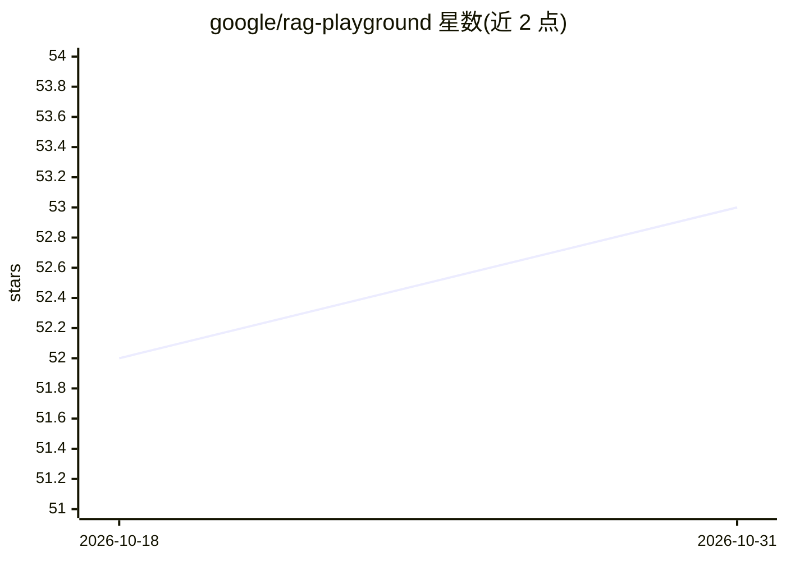

# google/rag-playground

⭐ 53 · Python · Apache-2.0 · 推送 2026-06-18 · [GitHub](https://github.com/google/rag-playground) · 组织维护

**在自有数据上对比实验 RAG 检索方法与 LLM 的平台**

GoogleCloudPlatform 维护的 RAG 实验/评测框架：通过统一界面配置解析、分块、检索与回答组件，在同一数据集上对比不同检索方法（Top-K、Multi-Query、上下文压缩等）与 Vertex AI LLM 的回答；内置自动评测（Vertex Rapid Evals）与用户投票机制，可将偏好沉淀为 gold standard 数据集。技术栈为 Streamlit 前端 + FastAPI 后端，部署于 GCP Cloud Functions/Workflows/Dataflow，数据管道基于 Apache Beam 与 LangChain。需 GCP 项目（含计费）方可运行，无本地零依赖安装路径。

## 筛选速览

| 维度 | 判定 | 备注 |
|---|---|---|
| AI 角色 | `ai-ecosystem` | LLM/agent 周边工具 |
| 许可风险 | `permissive` | Apache-2.0 |
| 部署形态 | `None` |  |
| 模型依赖 | — | README 未给出锁定关系 |
| 硬件要求 | — | 无带数字的原话,不猜 |
| 安装摩擦 | `low` | 无编译、无系统依赖或容器化 |
| 成熟度 | — | 结构信号不足 |

## 能力要点

- 统一界面对比多种检索方法与 LLM 的回答
- 自动评测 + 用户投票生成 gold standard 数据集
- Streamlit 前端 + Cloud Functions/Dataflow 微服务架构
- 数据管道基于 Apache Beam 与 LangChain，支持多种 loader/splitter/向量库

## 适用场景

- 在自有数据集上比较不同 RAG 配置的回答质量
- 构建可用于评测新 RAG 技术的 gold standard 数据集
- 收集用户偏好以评估或微调检索方案

## 场景标签

`RAG` `模型评测` · 领域:评测与运维

## 证据(README 行号)

> L3: RAG Playground is a platform to experiment with RAG (Retrieval Augmented Generation) techniques. It integrates with 
> L13: 1. Provide a unified interface to experiment with various RAG components and configurations (parsing, chunking, ret
> L15: 3. Provide automated side-by-side evaluations using first-party and third-party frameworks (e.g., Vertex GenAI Rapi

## 星数曲线

2026-10-18 52 → 2026-10-31 53（+1）

---
*卡片 v1 · prompt 1.4 · 生成 2026-10-24 · 置信度 high · 依据 README sha `701effe1938c` · [字段定义](../../DATASET.md)*
