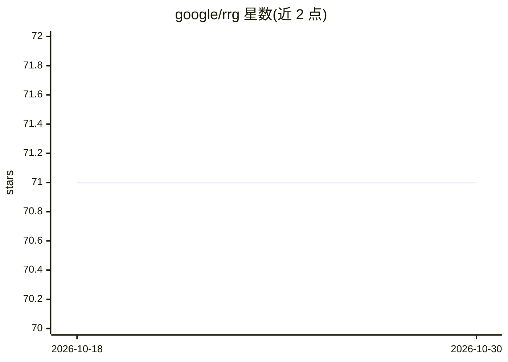

# google/rrg

⭐ 71 · Rust · MIT · 推送 2026-10-15 · [GitHub](https://github.com/google/rrg) · 组织维护

**GRR 取证 agent 的 Rust 重写实验项目**

RRG 是 GRR 远程实时取证框架客户端 agent 的 Rust 重写，属于实验性项目，非官方 Google 产品，明确声明不可用于生产环境。它不自建通信层，改用 Fleetspeak 进行通信，并借助 Rust 类型系统与安全保证评估能否解决原 Python 代码库的历史问题。构建依赖 Rust 工具链，需配合 Fleetspeak 与 GRR 组成完整系统才能实际使用；代码以 crates 组织（ospect 检查操作系统、rrg 实现 agent 动作、rrg-proto 生成 Protocol Buffers 代码）。

## 筛选速览

| 维度 | 判定 | 备注 |
|---|---|---|
| AI 角色 | `ai-enhanced` | 去掉 AI 部分产品仍成立 |
| 许可风险 | `permissive` | MIT |
| 部署形态 | `desktop` | 安装包/桌面程序 |
| 模型依赖 | — | README 未给出锁定关系 |
| 硬件要求 | — | 无带数字的原话,不猜 |
| 安装摩擦 | `medium` | 含编译或系统依赖之一 |
| 成熟度 | `idea` | |

## 能力要点

- GRR 客户端 agent 的 Rust 重写，不自建通信层而使用 Fleetspeak
- crates 结构：ospect 系统检查、rrg agent 动作入口、rrg-proto 协议生成代码
- 支持 Linux/macOS/Windows 多平台交叉编译检查

## 适用场景

- 作为 GRR/Fleetspeak 取证系统的客户端组件进行实验
- 研究 Rust 重写 Python 取证 agent 的可行性

## 场景标签

`网络安全` · 领域:学习与行业

## 证据(README 行号)

> L5: RRG is a *[Rust][rust] rewrite of [GRR][grr]* (a remote live forensics
> L8: It strives to evaluate how feasible it is to rewrite the client-side part of GRR

## 星数曲线

2026-10-18 71 → 2026-10-30 71（+0）

---
*卡片 v1 · prompt 1.4 · 生成 2026-10-24 · 置信度 high · 依据 README sha `375e93227260` · [字段定义](../../DATASET.md)*
