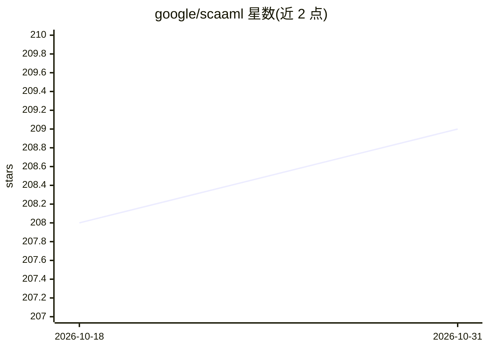

# google/scaaml

⭐ 209 · Python · Apache-2.0 · 推送 2026-10-30 · [GitHub](https://github.com/google/scaaml) · [官网](https://google.github.io/scaaml/) · 组织维护

**面向侧信道攻击的深度学习框架，含教程/模型/数据集**

基于 TensorFlow 2.x 的 Python 深度学习框架，用于执行硬件侧信道攻击。仓库包含 SCAAML 框架代码、AES 深度学习侧信道攻击分步教程（代码/数据集/模型）、GPAM 通用功耗攻击模型（可攻击多种算法）及大规模 ECC 数据集。要求 Python>=3.9 与 TensorFlow 2.x，通过 git clone 源码安装。附 CHES 论文与 DEF CON 演讲引文；声明非官方 Google 产品。

## 筛选速览

| 维度 | 判定 | 备注 |
|---|---|---|
| AI 角色 | `ai-ecosystem` | LLM/agent 周边工具 |
| 许可风险 | `permissive` | Apache-2.0 |
| 部署形态 | `library` | 以包/库形式分发 |
| 模型依赖 | — | README 未给出锁定关系 |
| 硬件要求 | — | 无带数字的原话,不猜 |
| 安装摩擦 | `low` | 无编译、无系统依赖或容器化 |
| 成熟度 | — | 结构信号不足 |

## 能力要点

- 基于 TensorFlow 2.x 的侧信道攻击深度学习框架
- GPAM：首个可攻击多种算法的功耗侧信道通用模型
- AES 深度学习侧信道攻击分步教程（含代码/数据集/模型）
- 大规模硬件保护 ECC 数据集可下载

## 适用场景

- 研究密码硬件的功耗侧信道攻击
- 学习深度学习 AES 侧信道攻击的实践方法
- 复现 CHES 论文中的攻击结果

## 场景标签

`网络安全` `教程课程` `科研工具` · 领域:学习与行业

## 证据(README 行号)

> L7: SCAAML (Side Channel Attacks Assisted with Machine Learning) is a deep learning
> L8: framework dedicated to side-channel attacks. It is written in python and run on

## 星数曲线

2026-10-18 208 → 2026-10-31 209（+1）

---
*卡片 v1 · prompt 1.4 · 生成 2026-10-22 · 置信度 mid · 依据 README sha `8bd650fc33d3` · [字段定义](../../DATASET.md)*
