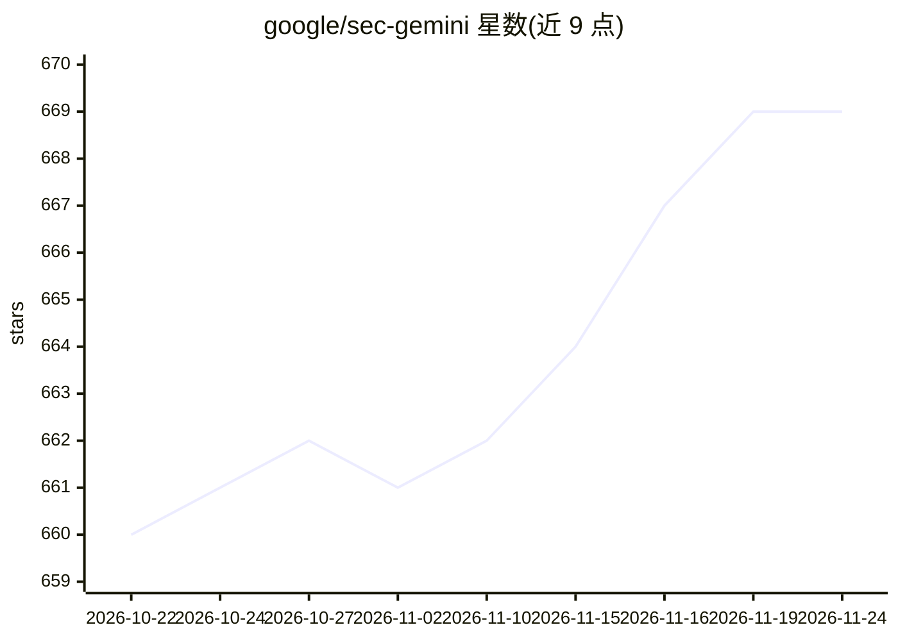

# google/sec-gemini

⭐ 669 · Jupyter Notebook · Apache-2.0 · 推送 2026-11-17 · [GitHub](https://github.com/google/sec-gemini) · [官网](https://secgemini.google/) · 组织维护

**Google 的网络安全专注 AI agent 及其 Python SDK**

Sec-Gemini 是 Google 推出的实验性网络安全方向 agent，目前处于邀请制 trusted-tester 阶段，普通用户无法直接注册使用。仓库本身主要提供 Python SDK 与 TUI（PyPI 包 sec-gemini），通过 SDK 可连接服务、创建会话、发送提示、流式接收响应、上传文件；支持 BYOT（Bring-Your-Own-Tools）接入本地工具与自定义 FastMCP 服务器，支持创建与上传自定义 skills，并附 DFIR 数字取证与日志分析示例 notebook。

## 筛选速览

| 维度 | 判定 | 备注 |
|---|---|---|
| AI 角色 | `ai-native` | 本体是模型或模型工具 |
| 许可风险 | `permissive` | Apache-2.0 |
| 部署形态 | `library` | 以包/库形式分发 |
| 模型依赖 | — | README 未给出锁定关系 |
| 硬件要求 | — | 无带数字的原话,不猜 |
| 安装摩擦 | `low` | 无编译、无系统依赖或容器化 |
| 成熟度 | `idea` | |

## 能力要点

- Python SDK 与 TUI，pip install sec-gemini 安装
- BYOT 机制接入本地工具与自定义 FastMCP 服务器
- 支持创建、上传并在会话中应用自定义 skills
- 提供 DFIR 数字取证与日志分析示例 notebook

## 适用场景

- 通过 SDK 在安全工作流中调用该 agent 的分析能力
- 用自带工具（BYOT）扩展 agent 的本地工具链
- 按 notebook 流程执行数字取证与日志分析

## 场景标签

`网络安全` `Agent 框架` · 领域:Agent 开发

## 证据(README 行号)

> L3: Sec-Gemini is an experimental cybersecurity-focused agent by Google. It is currently in an invite-only trusted-teste
> L17: * **Python SDK & TUI:** `sec-gemini` on PyPI (`pip install sec-gemini`)

## 星数曲线

2026-10-22 660 → 2026-11-24 669（+9）

---
*卡片 v1 · prompt 1.4 · 生成 2026-11-24 · 置信度 high · 依据 README sha `2666f35ee1af` · [字段定义](../../DATASET.md)*
