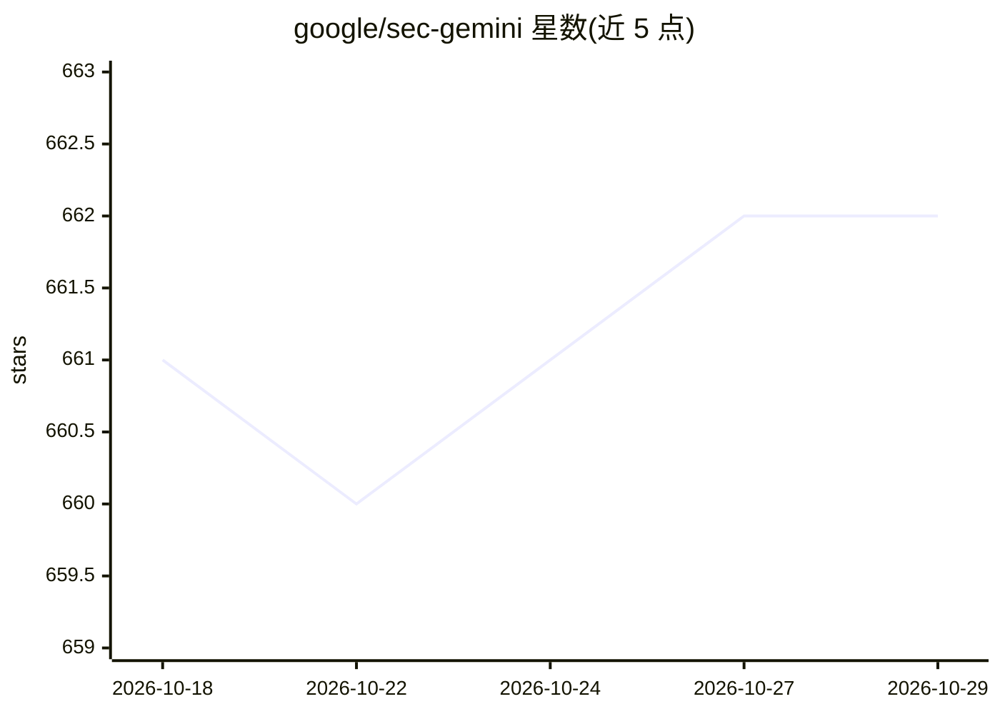

# google/sec-gemini

⭐ 662 · Svelte · Apache-2.0 · 推送 2026-09-17 · [GitHub](https://github.com/google/sec-gemini) · [官网](https://secgemini.google/) · 组织维护

**Google 安全 AI 模型 Sec-Gemini 的 Python/TS SDK 仓库**

托管 Google 实验性网络安全 AI 模型 Sec-Gemini 的官方 SDK：提供 Python（sec-gemini-python/）与 TypeScript（sec-gemini-ts/）两个目录，另提供 Web 组件（sec-gem-chat 标签）便于在网站中嵌入，组件支持 incognito 等属性配置。更多信息指向 secgemini.google。README 声明该项目非 Google 官方支持产品，且不参与 Google 开源漏洞奖励计划。未包含具体安装命令与 API 用法细节。

## 筛选速览

| 维度 | 判定 | 备注 |
|---|---|---|
| AI 角色 | `ai-ecosystem` | LLM/agent 周边工具 |
| 许可风险 | `permissive` | Apache-2.0 |
| 部署形态 | `None` |  |
| 模型依赖 | — | README 未给出锁定关系 |
| 硬件要求 | — | 无带数字的原话,不猜 |
| 安装摩擦 | `low` | 无编译、无系统依赖或容器化 |
| 成熟度 | `idea` | |

## 能力要点

- Python 与 TypeScript 两种语言的 SDK 目录
- 提供可嵌入网站的 sec-gem-chat Web 组件（支持 incognito、session-id 属性）
- 官方声明为实验性项目且非 Google 正式支持产品

## 适用场景

- 在安全工具或平台中集成 Sec-Gemini 模型能力
- 通过 Web 组件在自有网站嵌入 Sec-Gemini 对话界面

## 场景标签

`网络安全` `聊天机器人` · 领域:对话与助手

## 证据(README 行号)

> L3: This repository hosts SDKs for Sec-Gemini, an experimental cybersecurity-focused AI from Google.
> L9: * Python in `sec-gemini-python/`
> L12: We also have a web component to ease integration on your website. Here's how to load it:

## 星数曲线

2026-10-18 661 → 2026-10-29 662（+1）

---
*卡片 v1 · prompt 1.4 · 生成 2026-10-21 · 置信度 mid · 依据 README sha `5631fa150131` · [字段定义](../../DATASET.md)*
