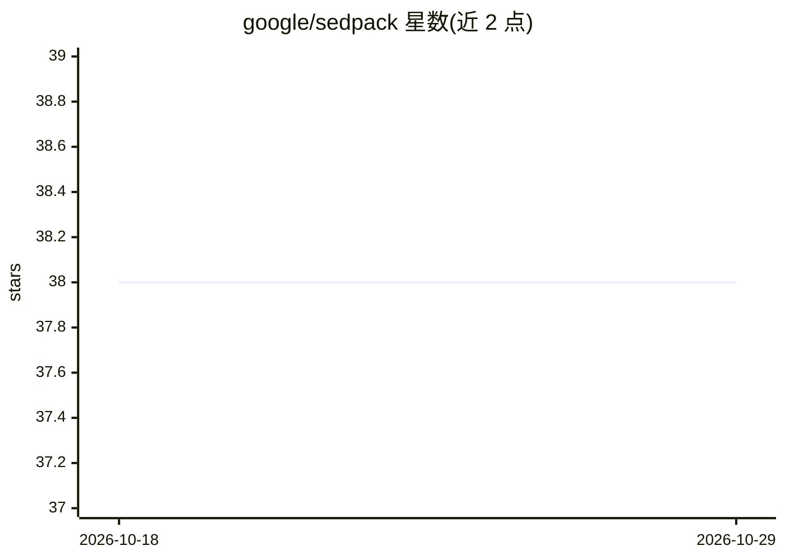

# google/sedpack

⭐ 38 · Python · Apache-2.0 · 推送 2026-10-28 · [GitHub](https://github.com/google/sedpack) · [官网](https://google.github.io/sedpack/) · 组织维护

**面向深度学习的数据打包与数据集存储 Python 库**

由 Google 托管的 Python 库（自 SCAAML 项目重构而来），提供可扩展、高效的数据打包能力，支持多种 shard 格式（含 tfrec），可通过 Dataset.as_tfdataset 转为 TensorFlow 数据集。TensorFlow 2.x 为可选依赖，仅在 tfrec 格式或 tfdataset 功能时需要。安装支持 pip 发布包与源码开发模式（含 Python 与 Rust/maturin 两条路径），文档与 MNIST 入门教程在 google.github.io/sedpack 提供。

## 筛选速览

| 维度 | 判定 | 备注 |
|---|---|---|
| AI 角色 | `ai-ecosystem` | LLM/agent 周边工具 |
| 许可风险 | `permissive` | Apache-2.0 |
| 部署形态 | `library` | 以包/库形式分发 |
| 模型依赖 | — | README 未给出锁定关系 |
| 硬件要求 | — | 无带数字的原话,不猜 |
| 安装摩擦 | `medium` | 含编译或系统依赖之一 |
| 成熟度 | — | 结构信号不足 |

## 能力要点

- 支持 tfrec shard 格式与 as_tfdataset 转换
- TensorFlow 为可选依赖（sedpack[tf]）
- 提供 pip 发布包与源码开发/Rust(maturin) 安装路径
- MNIST hello world 教程与文档网站

## 适用场景

- 为深度学习训练高效打包与读取数据集
- 在 TensorFlow 训练管线中作为数据加载层
- 需要可扩展数据存储格式的 ML 数据工程

## 场景标签

 · 领域:机器学习/数据工程

## 证据(README 行号)

> L1: # Sedpack - Scalable and efficient data packing
> L7: Mainly refactored from the SCAAML project.

## 星数曲线

2026-10-18 38 → 2026-10-29 38（+0）

---
*卡片 v1 · prompt 1.4 · 生成 2026-10-25 · 置信度 high · 依据 README sha `7b6056a45eef` · [字段定义](../../DATASET.md)*
