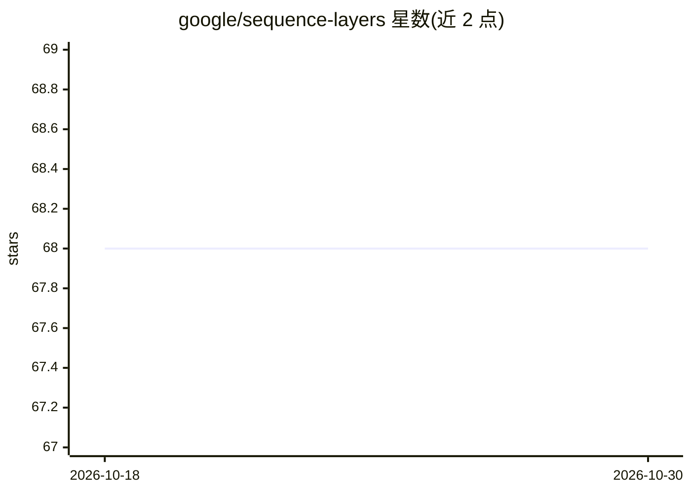

# google/sequence-layers

⭐ 68 · Python · Apache-2.0 · 推送 2026-06-26 · [GitHub](https://github.com/google/sequence-layers) · 组织维护

**JAX/MLX/TF2 序列建模网络层库：支持逐层与逐步执行**

面向序列建模研究的神经网络层 API 与库，同一模型可用声明式语法定义一次，即同时支持逐层处理（如 teacher-forced 训练）与逐步处理（如自流回归采样），并缓解流式与并行处理中 padding、重采样、因果性相关的常见 bug。可在卷积、循环、注意力等范式间组合，每层提供 tf.lite 部署路径。默认仅安装 JAX 支持，MLX 与 TensorFlow 为可选安装。技术报告可引用。

## 筛选速览

| 维度 | 判定 | 备注 |
|---|---|---|
| AI 角色 | `ai-ecosystem` | LLM/agent 周边工具 |
| 许可风险 | `permissive` | Apache-2.0 |
| 部署形态 | `library` | 以包/库形式分发 |
| 模型依赖 | — | README 未给出锁定关系 |
| 硬件要求 | — | 无带数字的原话,不猜 |
| 安装摩擦 | `low` | 无编译、无系统依赖或容器化 |
| 成熟度 | — | 结构信号不足 |

## 能力要点

- 单一声明式实现同时支持逐层（训练）与逐步（采样/流式）执行
- 缓解流式与并行序列处理中 padding/重采样/因果性常见 bug
- 支持卷积、循环、注意力架构混用，每层提供 tf.lite 部署路径
- 提供 JAX、MLX、TF2 三种框架后端（后两者需可选安装）

## 适用场景

- 构建可流式运行的实时序列模型（如音频实时生成）
- 研究与生产共用同一模型定义，避免训练与采样两套实现的不一致
- 在 Apple silicon 上用 MLX 运行序列模型

## 场景标签

 · 领域:深度学习/序列建模

## 证据(README 行号)

> L3: A neural network API and library (in JAX, MLX, TF2) to easily create sequence models that execute both layer-by-laye
> L32: A key feature of the library is that layers support streaming (step-by-step)

## 星数曲线

2026-10-18 68 → 2026-10-30 68（+0）

---
*卡片 v1 · prompt 1.4 · 生成 2026-10-24 · 置信度 high · 依据 README sha `1143b27158f8` · [字段定义](../../DATASET.md)*
