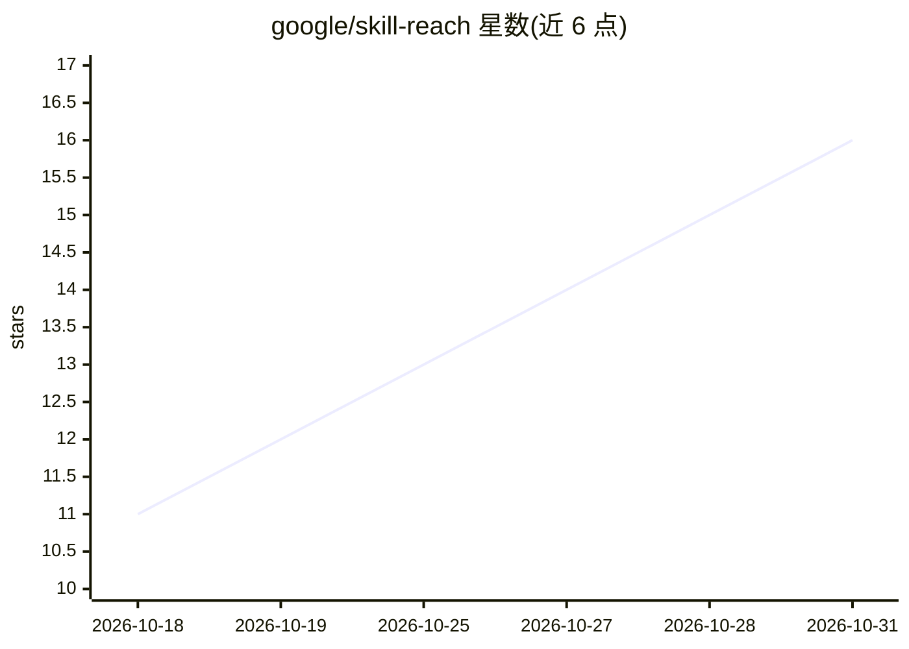

# google/skill-reach

⭐ 16 · Python · Apache-2.0 · 推送 2026-10-30 · [GitHub](https://github.com/google/skill-reach) · [官网](https://google.github.io/skill-reach/) · 组织维护

**AI agent 技能触发与碰撞的评测套件：测路由是否命中**

Google 维护的 Python 评测工具，度量 agent 技能的发现与选择阶段：用户查询是否路由到正确技能、多步工具交接轨迹是否可达目标能力、竞争描述下是否出现冗余调用。提供 lint/overlap/eval/optimize/sweep/diff 等 15 个以上命令，含 BM25 词法碰撞分析（离线无 API）、闭环描述优化、HTML 报告与多步轨迹指标（入口准确率、轨迹可达性、MRR、F1、冗余度）。支持 Gemini API、Vertex AI/ADC、Claude Code CLI 等运行时，需要 Python 3.12+ 与 uv 安装。

## 筛选速览

| 维度 | 判定 | 备注 |
|---|---|---|
| AI 角色 | `ai-ecosystem` | LLM/agent 周边工具 |
| 许可风险 | `permissive` | Apache-2.0 |
| 部署形态 | `self-host` | docker 或自建部署 |
| 模型依赖 | — | README 未给出锁定关系 |
| 硬件要求 | — | 无带数字的原话,不猜 |
| 安装摩擦 | `low` | 无编译、无系统依赖或容器化 |
| 成熟度 | — | 结构信号不足 |

## 能力要点

- 入口准确率/轨迹可达性/MRR/F1/冗余度等多步轨迹指标
- reach overlap 基于 BM25 的离线词汇碰撞分析与改写建议
- 闭环描述优化：合成候选描述并用实测探针评选
- reach lint 校验技能清单 schema、长度边界与命名碰撞，可作 CI/CD 质量门

## 适用场景

- 技能目录上线前检测描述碰撞与路由误触发
- CI 流水线中对技能清单做静态与实证回归门禁
- 自动改写技能描述以降低被相邻技能截流的概率

## 场景标签

`模型评测` · 领域:评测与运维

## 证据(README 行号)

> L8: An evaluation suite for AI agent skill routing, collision detection, multi-step trajectory evaluation, and descripti
> L10: While standard evaluation suites measure skill execution after invocation, `skill-reach` measures the discovery and

## 星数曲线

2026-10-18 11 → 2026-10-31 16（+5）

---
*卡片 v1 · prompt 1.4 · 生成 2026-10-30 · 置信度 mid · 依据 README sha `2c56fac3cf92` · [字段定义](../../DATASET.md)*
