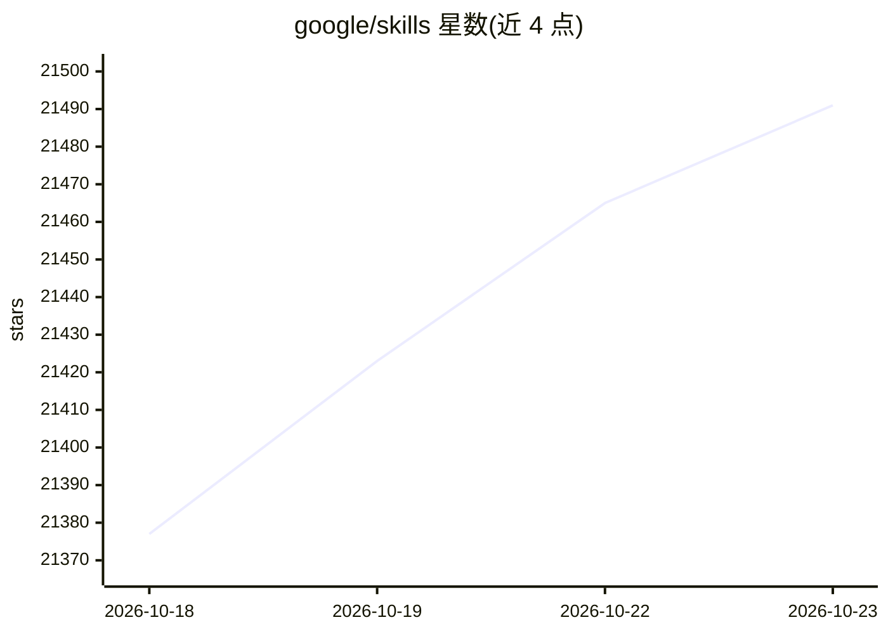

# google/skills

⭐ 21,491 · Python · Apache-2.0 · 推送 2026-10-22 · [GitHub](https://github.com/google/skills) · 组织维护

**Google 产品与云技术的 AI agent 技能库（含插件）**

Google 维护的 Agent Skills 仓库，收录面向 Google Cloud、GKE、BigQuery、SecOps、Ads 等产品技术的技能条目，按基础设施、数据库分析、安全、托管等类别组织。通过 npx skills add 安装，可选择性安装到指定 agent，也捆绑面向 Claude Code、Codex、Antigravity CLI 的插件（技能+MCP 服务器），并提供 npx skills update 更新与清理。README 未说明技能总数与许可证全文。

## 筛选速览

| 维度 | 判定 | 备注 |
|---|---|---|
| AI 角色 | `ai-knowledge` | 知识聚合/清单类 |
| 许可风险 | `permissive` | Apache-2.0 |
| 部署形态 | `library` | 以包/库形式分发 |
| 模型依赖 | — | README 未给出锁定关系 |
| 硬件要求 | — | 无带数字的原话,不猜 |
| 安装摩擦 | `low` | 无编译、无系统依赖或容器化 |
| 成熟度 | — | 结构信号不足 |

## 动量与使用信号

- 维护:`active` — 距上次 push 1.5 天,年发版 0,7 位贡献者
- 涨星:近 1 天 **+27**(自 20261016 起算)
- 安装:npm 包 `skills` 月下载 23,786,800
- 平台:— · 协议:MCP

## 能力要点

- 覆盖 Google Cloud、GKE、BigQuery、SecOps、Ads 等产品线的技能清单
- npx skills add 安装，支持选择技能、目标 agent 与项目/全局作用域
- 捆绑 Claude Code / Codex / Antigravity CLI 插件（Skills + MCP servers）
- npx skills update 支持更新并移除过期技能

## 适用场景

- 为 AI agent 配置 Google Cloud 操作与排障能力
- 通过插件机制在 Claude Code/Codex 中接入 Google 技能与 MCP 服务器
- 查找 GKE、BigQuery、SecOps 等领域现成的 agent 技能

## 场景标签

`Agent 框架` · 领域:Agent 开发

## 证据(README 行号)

> L5: This repository contains Agent Skills for Google
> L225: This repo also bundles Google product plugins (Skills + MCP servers) for agent harnesses.

## 星数曲线

2026-10-18 21,377 → 2026-10-23 21,491（+114）

---
*卡片 v1 · prompt 1.4 · 生成 2026-10-20 · 置信度 high · 依据 README sha `f754a0240ded` · [字段定义](../../DATASET.md)*
