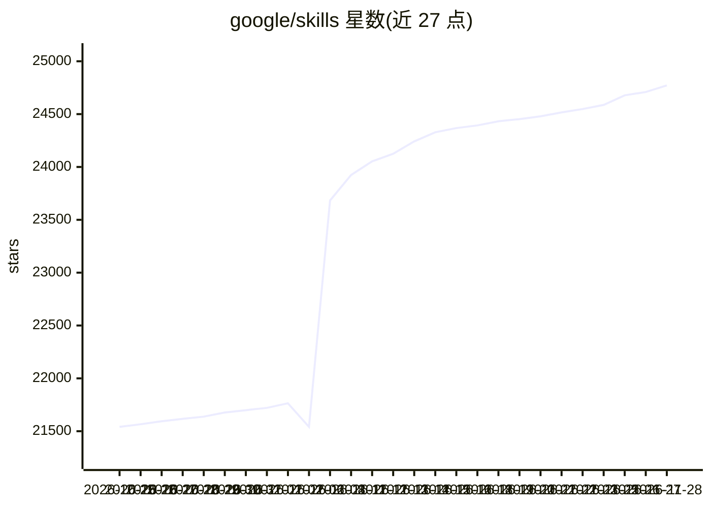

# google/skills

⭐ 24,772 · Python · Apache-2.0 · 推送 2026-11-27 · [GitHub](https://github.com/google/skills) · 组织维护

**给 AI agent 安装 Google 产品与 Google Cloud 技能的官方集合**

Google 官方发布的 Agent Skills 仓库，收录面向 Google 产品与 Google Cloud 的技能，按入门、AI/ML、基础设施、数据库与分析、开发者工具、安全与身份、广告等十余个类别组织，覆盖 GKE、BigQuery、IAM、Gemini/Genkit、SecOps 等条目。通过 skills.sh 的 npx 命令安装并可更新/移除过期技能，同时捆绑 Skills + MCP server 形式的插件，支持在 Claude Code、Codex、Antigravity CLI 三种 agent harness 的插件市场中安装。

## 筛选速览

| 维度 | 判定 | 备注 |
|---|---|---|
| AI 角色 | `ai-knowledge` | 知识聚合/清单类 |
| 许可风险 | `permissive` | Apache-2.0 |
| 部署形态 | `library` | 以包/库形式分发 |
| 模型依赖 | — | README 未给出锁定关系 |
| 硬件要求 | — | 无带数字的原话,不猜 |
| 安装摩擦 | `low` | 无编译、无系统依赖或容器化 |
| 成熟度 | — | 结构信号不足 |

## 动量与使用信号

- 维护:`active` — 距上次 push 1.5 天,年发版 0,7 位贡献者
- 涨星:近 1 天 **+27**(自 20261016 起算)
- 安装:npm 包 `skills` 月下载 23,786,800
- 平台:— · 协议:MCP

## 能力要点

- npx skills add 一条命令选择并安装技能，支持项目级或全局范围
- 技能按 AI/ML、基础设施、数据库、安全等十余类别组织
- 捆绑 Skills + MCP server 插件，适配 Claude Code、Codex、Antigravity CLI 三种 harness
- 提供 npx skills update 更新并可移除过期技能

## 适用场景

- 为 Claude Code 等 agent 配置 Google Cloud 相关技能
- 让 agent 具备 GKE/BigQuery/IAM 等产品的操作与排障知识
- 按插件形式为 agent harness 安装 Google 产品工具

## 场景标签

`提示工程` · 领域:Agent 开发

## 证据(README 行号)

> L5: This repository contains Agent Skills for Google
> L31: ## Available Skills
> L278: This repo also bundles Google product plugins (Skills + MCP servers) for agent harnesses.

## 星数曲线

2026-10-25 21,541 → 2026-11-28 24,772（+3,231）

---
*卡片 v1 · prompt 1.4 · 生成 2026-11-27 · 置信度 high · 依据 README sha `94be23363fc8` · [字段定义](../../DATASET.md)*
