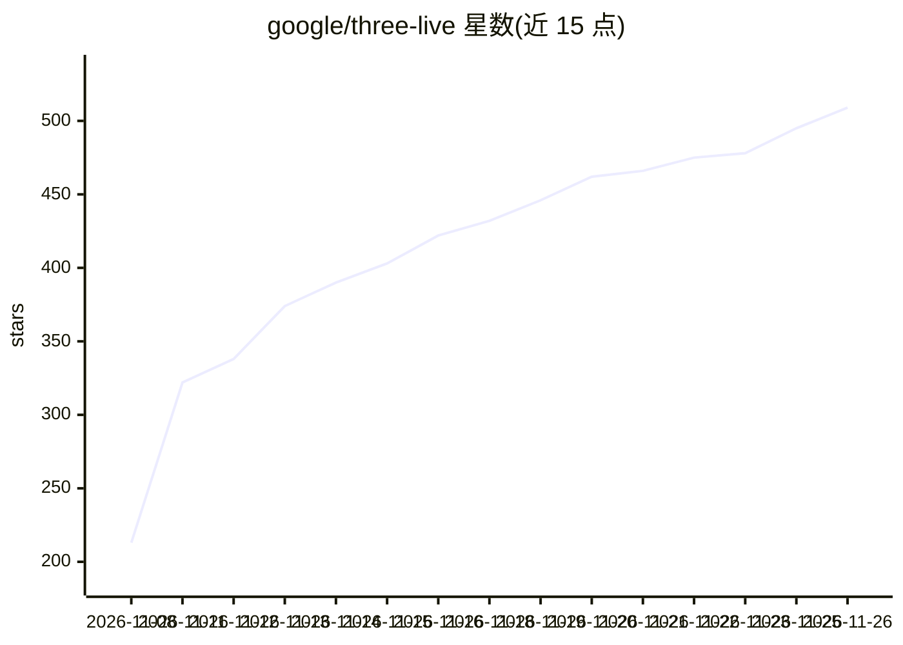

# google/three-live

⭐ 509 · TypeScript · Apache-2.0 · 推送 2026-11-25 · [GitHub](https://github.com/google/three-live) · [官网](https://google.github.io/three-live/) · 组织维护

**面向 AI 开发者的 Three.js 原生跨平台 3D 编译渲染运行时**

Three-Live 提供设备端 JIT 编译器与运行时，将 Three.js 代码编译为 Android（Google Filament 与 Jetpack XR SceneCore）、iOS/visionOS（Apple RealityKit）与 WebGL2/WebXR 的原生渲染。核心机制包括沙箱化 Rust VM 编译、无 GPU 的 headless 4 图校验渲染、MCP stdio server 供 AI agent 调用验证/转换/仿真，以及图片生成 Three.js 场景的闭环校验与自动修复。通过 LLM 编辑场景时先在沙箱编译并一次自动修复后才热替换。安装途径覆盖 JitPack/SwiftPM/Cargo/npm。

## 筛选速览

| 维度 | 判定 | 备注 |
|---|---|---|
| AI 角色 | `ai-ecosystem` | LLM/agent 周边工具 |
| 许可风险 | `permissive` | Apache-2.0 |
| 部署形态 | `desktop` | 安装包/桌面程序 |
| 模型依赖 | local-ok | 支持本地模型 |
| 硬件要求 | — | 无带数字的原话,不猜 |
| 安装摩擦 | `low` | 无编译、无系统依赖或容器化 |
| 成熟度 | — | 结构信号不足 |

## 能力要点

- Three.js 代码经沙箱 Rust VM 设备端编译，原生渲染于 Filament/RealityKit/WebXR
- MCP server 提供 validate/render/convert/from_image/gym 等 10 个工具供 agent 调用
- 支持从照片/草图/图纸生成场景，含 IoU 对比、质量门与一次自动修复
- 语音选物与本地引用解析（颜色/方位/序数/数量）在设备端完成，无模型调用

## 适用场景

- AI coding agent 生成并校验 Three.js 3D 场景后导出 glb/usdz
- 在 Android/iOS/visionOS 上原生渲染统一的 Three.js 场景
- 用户通过语音或对话修改 3D 场景中的物体
- 从参考图或 RoomPlan 扫描构建带真实尺度的 AR 场景

## 场景标签

`代码生成` · 领域:编码与开发

## 证据(README 行号)

> L5: **AI-First Native 3D, CAD & Spatial Computing:** On-device JIT compiler turning live, AI-generated **Three.js** into
> L63: `three-live-cli mcp` as a zero-dependency **Model Context Protocol (MCP)** stdio
> L100: Add `three-live-ai.min.js` (`< 35 KB gz`; built into the full bundles) to let

## 星数曲线

2026-11-08 213 → 2026-11-26 509（+296）

---
*卡片 v1 · prompt 1.4 · 生成 2026-11-25 · 置信度 high · 依据 README sha `5c3e3ff42570` · [字段定义](../../DATASET.md)*
