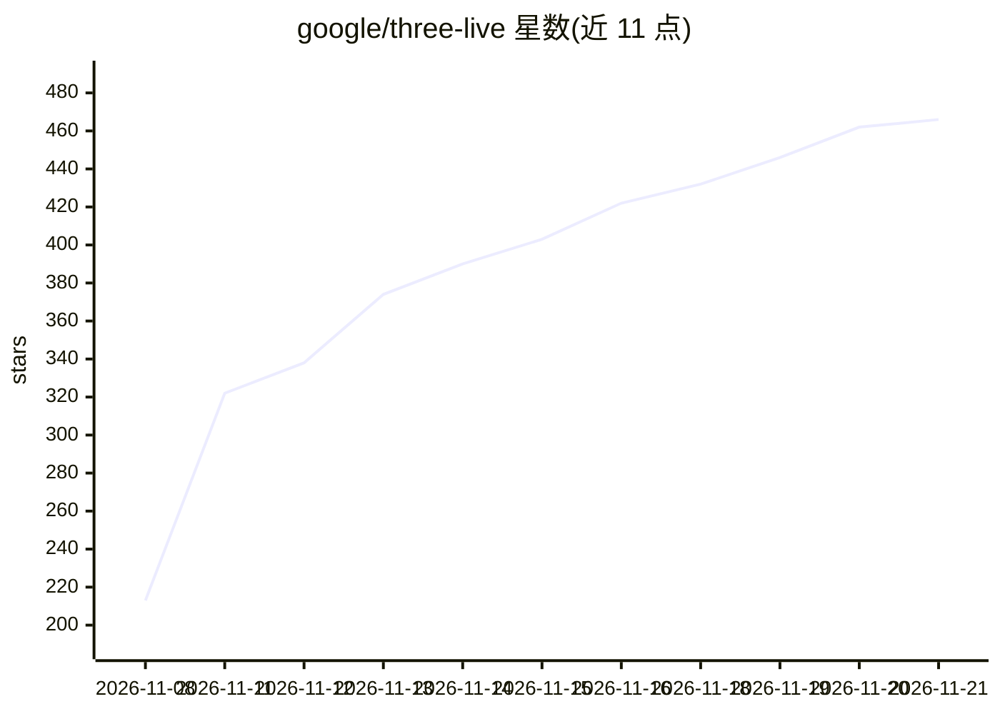

# google/three-live

⭐ 466 · TypeScript · Apache-2.0 · 推送 2026-11-20 · [GitHub](https://github.com/google/three-live) · [官网](https://google.github.io/three-live/) · 组织维护

**把 Three.js 代码 JIT 编译为原生 3D/XR 渲染的开发工具**

设备端 JIT 编译器与运行时：在沙箱化 Rust VM 中编译标准 Three.js 代码，渲染为 Android 的 Google Filament / Jetpack XR SceneCore、iOS/visionOS 的 Apple RealityKit（可导出 .usdz/.glb）、WebGL2/WebXR，以及 CLI 的无头 PNG 渲染。面向写 Three.js 的开发者和 AI 编码代理：提供 MCP 服务器、图像生成场景、语音改场景、AI 纹理生成与本地参照解析。通过 JitPack/SwiftPM/Cargo/npm 分发，官方声明非 Google 正式支持产品。

## 筛选速览

| 维度 | 判定 | 备注 |
|---|---|---|
| AI 角色 | `ai-ecosystem` | LLM/agent 周边工具 |
| 许可风险 | `permissive` | Apache-2.0 |
| 部署形态 | `desktop` | 安装包/桌面程序 |
| 模型依赖 | local-ok | 支持本地模型 |
| 硬件要求 | — | 无带数字的原话,不猜 |
| 安装摩擦 | `low` | 无编译、无系统依赖或容器化 |
| 成熟度 | — | 结构信号不足 |

## 能力要点

- 沙箱 Rust VM 设备端编译标准 Three.js（THREE.Mesh/CSG/KHR_interactivity）
- 一套代码渲染到 Filament/RealityKit/WebGL2/WebXR 四类目标
- three-live-cli 提供 MCP 服务器（渲染/转换/图像生成场景/agent gym 等工具）
- 任意 Chat Completions 兼容后端均可驱动场景编辑（Ollama/vLLM/OpenRouter 等）

## 适用场景

- 把 AI 生成的 Three.js 场景部署为移动端原生 XR 应用
- AI 编码代理通过 MCP 无头渲染并验证 3D 场景
- 网页中用语音或对话实时修改 Three.js 场景
- 从照片/草图/蓝图生成程序化 3D 场景

## 场景标签

 · 领域:图形/空间计算基础设施

## 证据(README 行号)

> L5: **AI-First Native 3D, CAD & Spatial Computing:** On-device JIT compiler turning live, AI-generated **Three.js** into
> L23: LLMs and developers excel at writing concise **Three.js** code—not hundreds of
> L26: `KHR_interactivity`) on-device in a sandboxed Rust VM and renders natively in

## 星数曲线

2026-11-08 213 → 2026-11-21 466（+253）

---
*卡片 v1 · prompt 1.4 · 生成 2026-11-17 · 置信度 high · 依据 README sha `860189a24c61` · [字段定义](../../DATASET.md)*
