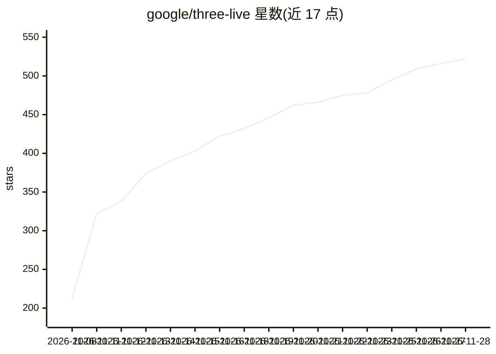

# google/three-live

⭐ 522 · TypeScript · Apache-2.0 · 推送 2026-11-27 · [GitHub](https://github.com/google/three-live) · [官网](https://google.github.io/three-live/) · 组织维护

**让 LLM/开发者生成的 Three.js 在移动与 XR 原生运行的 JIT 编译器**

设备端 JIT 编译器，把标准 Three.js 代码在沙箱 Rust VM 中编译后，以原生方式渲染到 Android（Filament 与 Jetpack XR SceneCore）、iOS/visionOS（RealityKit）、WebGL2/WebXR。提供 Android/iOS SDK 与 three-live-cli：无 GPU 渲染 4-up 校验图、空间 lint、导出 .glb/.usdz、从参考图合成场景，并可作为零依赖 MCP stdio server 接入 AI 编码 agent；Web 端 Web 组件支持 LLM 驱动的场景编辑、语音选择与纹理提示。Android 经 JitPack/Maven/AAR/源码安装，iOS 用 SwiftPM，另有 Cargo 与 npm 分发。

## 筛选速览

| 维度 | 判定 | 备注 |
|---|---|---|
| AI 角色 | `ai-enhanced` | 去掉 AI 部分产品仍成立 |
| 许可风险 | `permissive` | Apache-2.0 |
| 部署形态 | `desktop` | 安装包/桌面程序 |
| 模型依赖 | local-ok | 支持本地模型 |
| 硬件要求 | — | 无带数字的原话,不猜 |
| 安装摩擦 | `low` | 无编译、无系统依赖或容器化 |
| 成熟度 | `idea` | |

## 能力要点

- 同一份 Three.js 代码编译到 Android/iOS/visionOS/WebXR 原生渲染
- three-live-cli 提供 headless 校验渲染、空间 lint、.glb/.usdz 导出与 MCP server
- Web 端支持任意 LLM 的场景编辑（沙箱预编译+自动修复+热替换）与语音选择/编辑
- 从照片/草图/蓝图合成并校验 Three.js 场景（from-image，含 IoU 对比）

## 适用场景

- 让 AI 编码 agent 通过 MCP 校验和编译其生成的 3D 场景
- 把 Three.js 内容原生跑在 Android XR 和 visionOS 设备上
- 在网页中让用户用语音和自然语言修改 3D 场景
- 从照片或设计图生成可在手机 AR 中打开的场景

## 场景标签

`代码生成` · 领域:编码与开发

## 证据(README 行号)

> L5: **AI-First Native 3D, CAD & Spatial Computing:** On-device JIT compiler turning live, AI-generated **Three.js** into
> L26: `KHR_interactivity`) on-device in a sandboxed Rust VM and renders natively in
> L63: `three-live-cli mcp` as a zero-dependency **Model Context Protocol (MCP)** stdio

## 星数曲线

2026-11-08 213 → 2026-11-28 522（+309）

---
*卡片 v1 · prompt 1.4 · 生成 2026-11-28 · 置信度 high · 依据 README sha `e2aa2e9cae95` · [字段定义](../../DATASET.md)*
