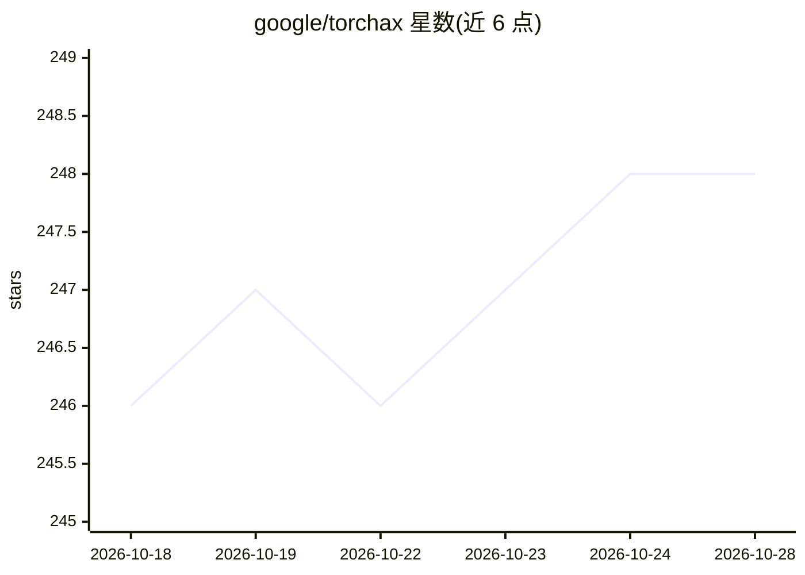

# google/torchax

⭐ 249 · Python · Apache-2.0 · 推送 2026-10-22 · [GitHub](https://github.com/google/torchax) · [官网](https://google.github.io/torchax/) · 组织维护

**让 PyTorch 代码经 JAX 后端运行于 TPU 的互操作库**

torchax 是 PyTorch 的一个后端，使 PyTorch 程序能够在 Google Cloud TPU 上运行，并提供 PyTorch 与 JAX 之间的图级互操作。机制上通过 torch.Tensor 子类持有 jax.Array 并重写 __torch_dispatch__，将 PyTorch 算子替换为 JAX 等价实现。用户可在 PyTorch 代码中调用 jax.grad、optax、GSPMD 训练模型，或用 jax.jit 编译加速。提供 checkpoint 保存加载、JittableModule 辅助类。由 Google Cloud 团队维护，通过 pip 从 PyPI 或源码安装。

## 筛选速览

| 维度 | 判定 | 备注 |
|---|---|---|
| AI 角色 | `ai-ecosystem` | LLM/agent 周边工具 |
| 许可风险 | `permissive` | Apache-2.0 |
| 部署形态 | `library` | 以包/库形式分发 |
| 模型依赖 | — | README 未给出锁定关系 |
| 硬件要求 | — | 无带数字的原话,不猜 |
| 安装摩擦 | `low` | 无编译、无系统依赖或容器化 |
| 成熟度 | — | 结构信号不足 |

## 能力要点

- 以 JAX 为后端运行 PyTorch 程序，代码改动少
- PyTorch 与 JAX 双向调用：jax.Array 传入 PyTorch 函数、torch.Tensor 传入 JAX 函数
- 通过 __torch_dispatch__ 算子替换实现，支持 jax.jit 编译加速
- 提供 torchax.save_checkpoint / load_checkpoint 训练状态保存

## 适用场景

- 把已有 PyTorch 模型迁移到 Google Cloud TPU 上运行
- 在 PyTorch 训练流程中使用 JAX 的 jax.grad 与 optax
- 将 PyTorch 模型作为特征提取器接入 JAX 模型

## 场景标签

`推理引擎` · 领域:训练与推理

## 证据(README 行号)

> L6: **torchax** is a backend for PyTorch that allows users to run
> L7: PyTorch programs on Google Cloud TPUs. It also provides graph-level
> L88: torchax uses a `torch.Tensor` subclass, `torchax.tensor.Tensor`, which holds a
> L89: `jax.Array` and overrides the `__torch_dispatch__` method. When a PyTorch operation

## 星数曲线

2026-10-18 246 → 2026-10-28 248（+2）

---
*卡片 v1 · prompt 1.4 · 生成 2026-10-22 · 置信度 high · 依据 README sha `8408d802e77e` · [字段定义](../../DATASET.md)*
