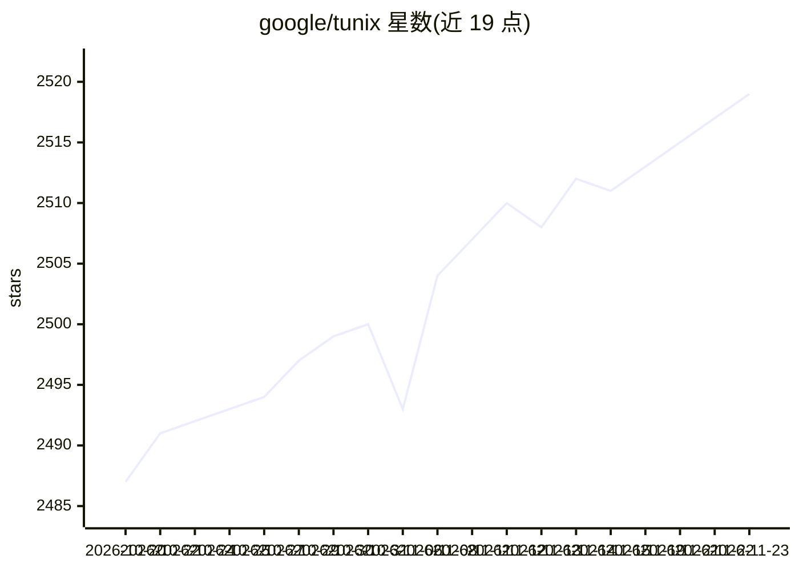

# google/tunix

⭐ 2,519 · Python · Apache-2.0 · 推送 2026-11-22 · [GitHub](https://github.com/google/tunix) · 组织维护

**JAX 生态 LLM 后训练库：SFT/RL/Agentic RL 微调**

Tunix 是运行在 TPU/加速器上的 LLM 后训练库，基于 JAX 构建，位于 Flax/Optax/Orbax 等基础工具与 MaxText 等优化模型之间的中间层。提供监督微调（全量/PEFT/DPO/ORPO）、强化学习（PPO/GRPO/GSPO-Token/DAPO/Dr.GRPO）与 Agentic RL（多轮工具调用、异步 rollout）能力，通过 vLLM 做 rollout，支持 Pathways 多主机分布式训练、检查点容错与 XProf 性能剖析。项目处于早期开发阶段，贡献流程仍在规范化。

## 筛选速览

| 维度 | 判定 | 备注 |
|---|---|---|
| AI 角色 | `ai-ecosystem` | LLM/agent 周边工具 |
| 许可风险 | `permissive` | Apache-2.0 |
| 部署形态 | `self-host` | docker 或自建部署 |
| 模型依赖 | local-ok | 支持本地模型 |
| 硬件要求 | — | 无带数字的原话,不猜 |
| 安装摩擦 | `low` | 无编译、无系统依赖或容器化 |
| 成熟度 | `idea` | |

## 能力要点

- 覆盖 SFT、DPO/ORPO 偏好优化与 PPO/GRPO 等多种 RL 算法
- Agentic RL 支持多轮工具调用与异步 rollout
- vLLM on TPU 原生集成用于 rollout，MaxText 原生集成
- Pathways 多主机分布式训练可扩展至数千设备

## 适用场景

- 在 TPU 上对 Gemma/Llama/Qwen 模型做监督微调或 DPO 训练
- 对 LLM 进行 GRPO/PPO 强化学习后训练
- 构建多轮工具调用的 Agentic RL 训练流程

## 场景标签

`微调` `强化学习` · 领域:训练与推理

## 证据(README 行号)

> L1: # Tunix: A Lightweight LLM Post-Training Library
> L3: **Tunix (Tune-in-Accelerators)** is a unified library designed to streamline the
> L25: Tunix serves as a state-of-the-art post-training library within the JAX training

## 星数曲线

2026-10-20 2,487 → 2026-11-23 2,519（+32）

---
*卡片 v1 · prompt 1.4 · 生成 2026-11-23 · 置信度 high · 依据 README sha `862af1a60550` · [字段定义](../../DATASET.md)*
