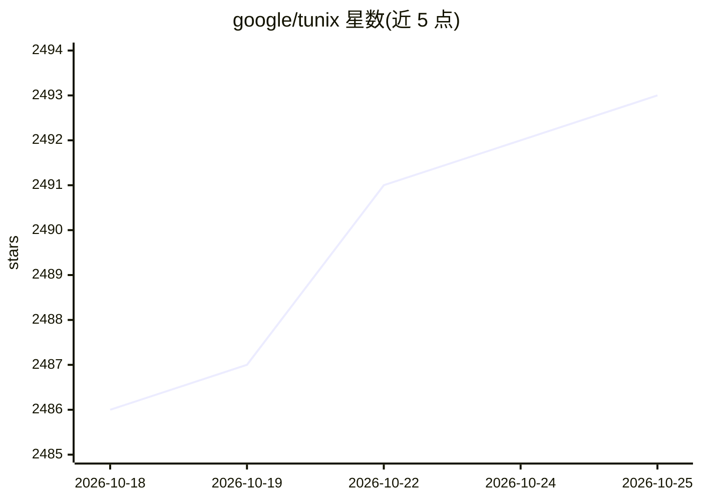

# google/tunix

⭐ 2,493 · Python · Apache-2.0 · 推送 2026-10-25 · [GitHub](https://github.com/google/tunix) · 组织维护

**基于 JAX 的 LLM 后训练库：支持 SFT、RL 与 Agentic RL**

Tunix（Tune-in-JAX）是 Google 维护的 JAX 后训练库，覆盖监督微调（全量、PEFT、DPO、ORPO）、强化学习（PPO、GRPO、GSPO-Token、DAPO、Dr.GRPO）与 Agentic RL（多轮工具使用、异步 rollout、轨迹批处理）。它位于 Flax/Optax/Orbax 等基础工具与 MaxText/MaxDiffusion 优化模型之间，通过 vLLM 和 SGLang-JAX 做 rollout，支持 Pathways 多主机分布式训练与容错。支持 Gemma、Llama、Qwen 系列模型，面向 TPU 训练场景；当前处于 V2 阶段、仍在活跃开发中。

## 筛选速览

| 维度 | 判定 | 备注 |
|---|---|---|
| AI 角色 | `ai-ecosystem` | LLM/agent 周边工具 |
| 许可风险 | `permissive` | Apache-2.0 |
| 部署形态 | `self-host` | docker 或自建部署 |
| 模型依赖 | local-ok | 支持本地模型 |
| 硬件要求 | — | 无带数字的原话,不猜 |
| 安装摩擦 | `low` | 无编译、无系统依赖或容器化 |
| 成熟度 | `idea` | |

## 能力要点

- SFT（全量/PEFT/DPO/ORPO）与多种 RL 算法（PPO/GRPO/GSPO-Token/DAPO/Dr.GRPO）
- Agentic RL：多轮工具使用、异步 rollout、轨迹批处理与分组
- vLLM 与 SGLang-JAX 的 rollout 集成，Pathways 多主机分布式可扩展至数千设备
- 基于 JAX 栈（Flax NNX、Optax、Orbax、MaxText），面向 TPU 训练性能

## 适用场景

- 在 TPU 上对 Gemma/Llama/Qwen 模型做 SFT 或 RL 后训练
- 开展 Agentic RL 训练（多轮工具使用与异步轨迹采集）
- 在 JAX 生态中构建可扩展的分布式 LLM 训练流程

## 场景标签

`微调` `强化学习` · 领域:训练与推理

## 证据(README 行号)

> L3: **Tunix (Tune-in-JAX)** is a JAX based library designed to streamline the
> L25: Tunix serves as a state-of-the-art post-training library within the JAX training

## 星数曲线

2026-10-18 2,486 → 2026-10-25 2,493（+7）

---
*卡片 v1 · prompt 1.4 · 生成 2026-10-21 · 置信度 high · 依据 README sha `c70a41d21171` · [字段定义](../../DATASET.md)*
