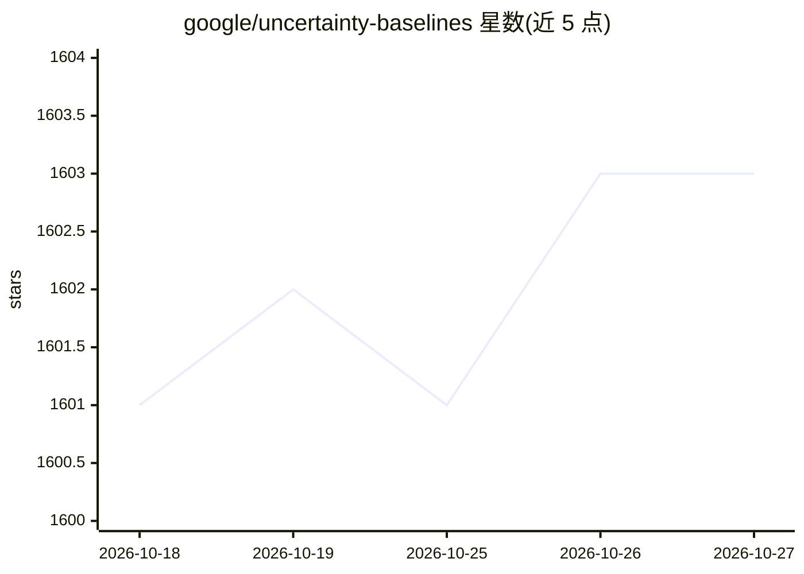

# google/uncertainty-baselines

⭐ 1,603 · Python · Apache-2.0 · 推送 2026-10-20 · [GitHub](https://github.com/google/uncertainty-baselines) · 组织维护

**深度学习不确定性与鲁棒性基准方法实现库，面向科研者**

Google 维护的不确定性与鲁棒性基准集合：提供标准与先进方法的高质量实现（如 BatchEnsemble、Wide ResNet），按训练数据集组织在 baselines/ 目录，含数据集模块（遵循 TensorFlow Datasets API）与模型模块（遵循 tf.keras API），定义测试精度、校准误差（ECE）、NLL、训练/测试耗时等指标。尚未发布稳定版本，API 可能变化；安装库后不自动安装后端，需自行安装 TensorFlow 等依赖；复现基线常需 TPU（可用 Colab 免费资源）。

## 筛选速览

| 维度 | 判定 | 备注 |
|---|---|---|
| AI 角色 | `ai-ecosystem` | LLM/agent 周边工具 |
| 许可风险 | `permissive` | Apache-2.0 |
| 部署形态 | `library` | 以包/库形式分发 |
| 模型依赖 | — | README 未给出锁定关系 |
| 硬件要求 | — | 无带数字的原话,不猜 |
| 安装摩擦 | `low` | 无编译、无系统依赖或容器化 |
| 成熟度 | `idea` | |

## 能力要点

- 按训练数据集组织的基线脚本，彼此低耦合、易于 fork
- ub.datasets 与 ub.models 模块遵循 tf.keras/tfds API
- 定义 ECE、NLL、运行时等统一评测指标
- 支持 TPU/Colab/GPU 多种运行途径，结果取 10 次运行均值

## 适用场景

- 快速原型化不确定性与鲁棒性研究新方法
- 与标准基线做可对比的实验
- 在 CIFAR-10 等标准任务上复现已发表方法

## 场景标签

`模型评测` `科研工具` · 领域:评测与运维

## 证据(README 行号)

> L10: 1. Provide high-quality implementations of standard and state-of-the-art methods
> L14: 3. Prescribe best practices for uncertainty and robustness benchmarking.

## 星数曲线

2026-10-18 1,601 → 2026-10-27 1,603（+2）

---
*卡片 v1 · prompt 1.4 · 生成 2026-10-21 · 置信度 high · 依据 README sha `237909e636e9` · [字段定义](../../DATASET.md)*
