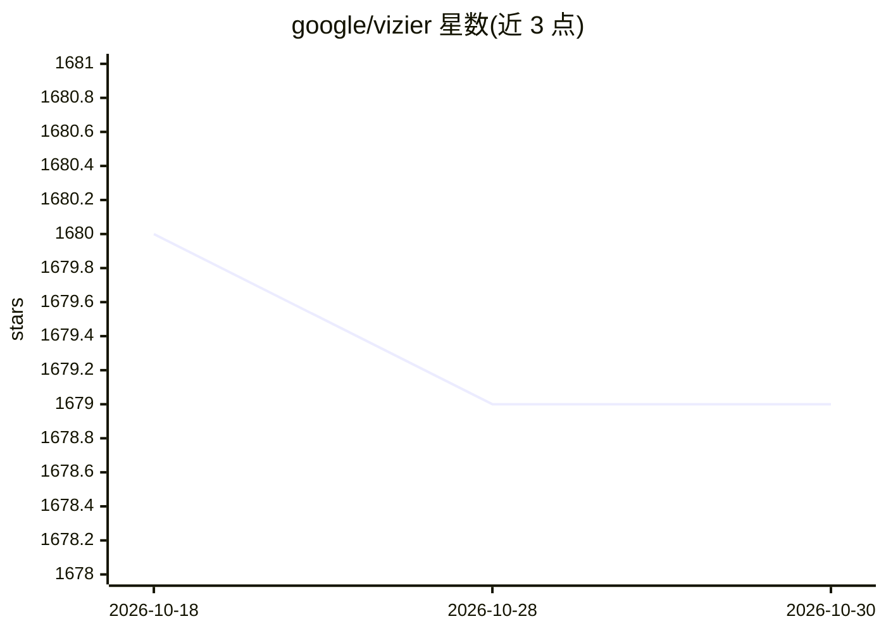

# google/vizier

⭐ 1,679 · Python · Apache-2.0 · 推送 2026-10-20 · [GitHub](https://github.com/google/vizier) · [官网](https://oss-vizier.readthedocs.io) · 组织维护

**黑盒优化与超参调优的 Python 服务，源自 Google Vizier**

基于内部 Google Vizier 服务的 Python 黑盒优化接口与分布式客户端-服务器系统，提供 User API（优化黑盒目标、可搭分布式多客户端服务器）、Developer API（实现新优化算法）、Benchmarking API（目标函数与算法基准对比），并有 TensorFlow Probability 贝叶斯优化与 PyGlove 大规模进化实验的高级 API。pip 安装，支持 JAX 贝叶斯优化器等可选组件；完整安装需 Python 3.10+，客户端包需 3.8+。面向研究与调参场景。

## 筛选速览

| 维度 | 判定 | 备注 |
|---|---|---|
| AI 角色 | `ai-ecosystem` | LLM/agent 周边工具 |
| 许可风险 | `permissive` | Apache-2.0 |
| 部署形态 | `library` | 以包/库形式分发 |
| 模型依赖 | — | README 未给出锁定关系 |
| 硬件要求 | — | 无带数字的原话,不猜 |
| 安装摩擦 | `low` | 无编译、无系统依赖或容器化 |
| 成熟度 | — | 结构信号不足 |

## 能力要点

- 三个主 API：User / Developer / Benchmarking
- 分布式客户端-服务器架构，支持多客户端设置
- JAX 贝叶斯优化器、TensorFlow Probability、PyGlove 高级 API
- 按需可选安装（jax/tf/algorithms/benchmarks 等附加组件）

## 适用场景

- 调优机器学习模型的超参数
- 研究并对比新的优化算法（含基准测试）
- 大规模分布式进化实验与程序搜索

## 场景标签

 · 领域:机器学习基础设施/优化

## 证据(README 行号)

> L17: OSS Vizier is a Python-based service for black-box optimization and research, based on Google Vizier, one of the fi
> L38: * **User API:** Allows a user to optimize their blackbox objective and optionally setup a server for distributed mu
> L39: * **Developer API:** Defines abstractions and utilities for implementing new optimization algorithms for research a

## 星数曲线

2026-10-18 1,680 → 2026-10-30 1,679（-1）

---
*卡片 v1 · prompt 1.4 · 生成 2026-10-21 · 置信度 high · 依据 README sha `9bda0969242c` · [字段定义](../../DATASET.md)*
