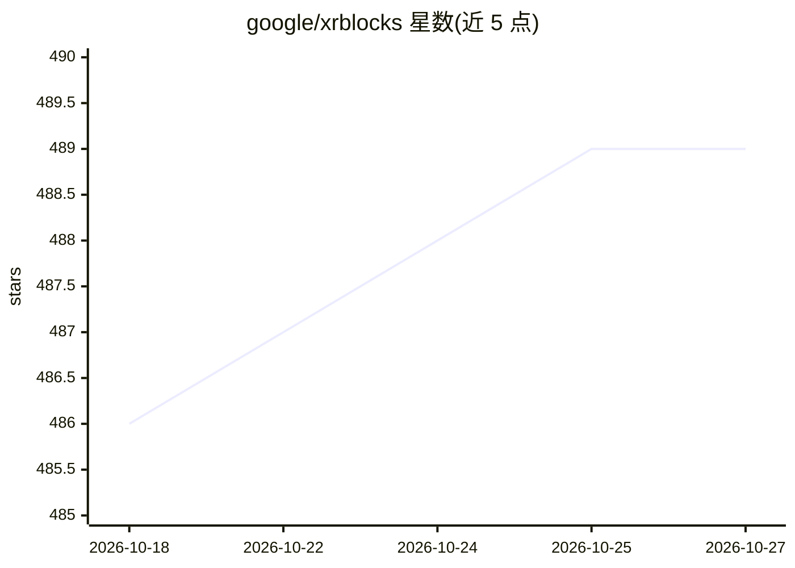

# google/xrblocks

⭐ 489 · TypeScript · Apache-2.0 · 推送 2026-10-26 · [GitHub](https://github.com/google/xrblocks) · [官网](https://xrblocks.github.io) · 组织维护

**面向开发者的 WebXR + AI 原型库：快速搭建沉浸式 AI 体验**

基于 three.js 的轻量跨平台 SDK，用于快速原型化 XR 与 AI 体验。目标平台为支持 WebXR 的 Chrome v136+（Android XR 设备及桌面 Chrome），并附桌面模拟器供开发。提供手势/头部手势识别（TensorFlow Lite / PyTorch 模型）、世界理解（深度感知、物体识别、人体姿态等）、统一交互管线、空间 UI 组件，以及接入 Gemini 云端服务的多模态与实时对话接口。非 AI 样例无需 API key；WebXR 与 LiteRT 数据在本机处理，Gemini 功能数据发送至其服务器。声明非官方 Google 产品，由 XR Labs 团队维护。

## 筛选速览

| 维度 | 判定 | 备注 |
|---|---|---|
| AI 角色 | `ai-ecosystem` | LLM/agent 周边工具 |
| 许可风险 | `permissive` | Apache-2.0 |
| 部署形态 | `None` |  |
| 模型依赖 | locked-api |  |
| 硬件要求 | — | 无带数字的原话,不猜 |
| 安装摩擦 | `low` | 无编译、无系统依赖或容器化 |
| 成熟度 | — | 结构信号不足 |

## 能力要点

- 手部/头部手势识别，支持 TensorFlow Lite / PyTorch 模型与六种手势检测
- 世界理解能力：深度感知、场景网格、物体识别、人体姿态、语义分割
- 通过 importmap 直接引入网页，一次编写可部署至 XR 设备与桌面 Chrome
- 接入 Gemini 的多模态理解与实时对话能力

## 适用场景

- 在浏览器/头显中快速原型化 AI + XR 应用
- 用桌面模拟器开发手部追踪与手势交互体验
- 构建由 Gemini 驱动的沉浸式对话与多模态应用

## 场景标签

`多模态` · 领域:感知与多模态

## 证据(README 行号)

> L26: **XR Blocks** is a lightweight, cross-platform library for rapidly prototyping
> L52: - **AI Integration:** Seamlessly connect to Gemini for multimodal

## 星数曲线

2026-10-18 486 → 2026-10-27 489（+3）

---
*卡片 v1 · prompt 1.4 · 生成 2026-10-21 · 置信度 high · 依据 README sha `a4251896bc1c` · [字段定义](../../DATASET.md)*
