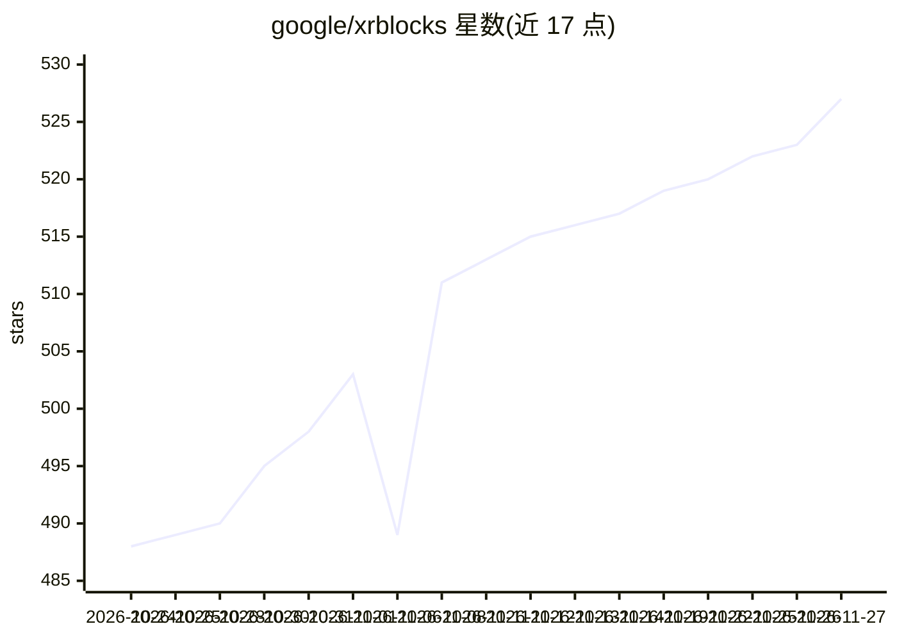

# google/xrblocks

⭐ 527 · TypeScript · Apache-2.0 · 推送 2026-11-26 · [GitHub](https://github.com/google/xrblocks) · [官网](https://xrblocks.github.io) · 组织维护

**面向开发者的 WebXR + AI 快速原型开发库**

基于 three.js 的跨平台 SDK，用于快速构建 AI + XR 体验：提供手部追踪与自定义手势（TensorFlow Lite/PyTorch 模型）、点头摇头检测、深度感知与场景语义理解、统一交互管线、空间 UI 组件，并通过 xb.context 向 agent 暴露场景语义树与截图。AI 功能接入 Gemini 实现多模态理解与实时对话；WebXR/LiteRT 数据在本地设备处理，Gemini 调用需 API key 并遵循其隐私条款。要求 Chrome v136+，支持 Android XR 设备与桌面模拟器。

## 筛选速览

| 维度 | 判定 | 备注 |
|---|---|---|
| AI 角色 | `ai-ecosystem` | LLM/agent 周边工具 |
| 许可风险 | `permissive` | Apache-2.0 |
| 部署形态 | `None` |  |
| 模型依赖 | locked-api |  |
| 硬件要求 | — | 无带数字的原话,不猜 |
| 安装摩擦 | `low` | 无编译、无系统依赖或容器化 |
| 成熟度 | — | 结构信号不足 |

## 能力要点

- 手部/头部手势识别，支持 pinch、open-palm、fist 等事件订阅
- 接入 Gemini 提供多模态理解与实时对话体验
- 向 agent 暴露场景语义树与 Set-of-Mark 截图（xb.context）
- 提供 GenXR-Bench：112 个任务评测编码 agent 的 XR 开发能力

## 适用场景

- 快速原型化运行在 Android XR 设备上的 WebXR 应用
- 在桌面模拟器中开发带手势交互的 3D 场景
- 用 Gemini 为 XR 应用添加多模态对话能力
- 让编码 agent 生成或修复 XR 应用并按 GenXR-Bench 评测

## 场景标签

`模型评测` `多模态` `Agent 框架` · 领域:Agent 开发

## 证据(README 行号)

> L30: **XR Blocks** is a lightweight, cross-platform library for rapidly prototyping
> L56: - **AI Integration:** Seamlessly connect to Gemini for multimodal
> L164: For additional agent-first development tools including UI visualizers, 3d model visualizers, CLI based embodied XR

## 星数曲线

2026-10-24 488 → 2026-11-27 527（+39）

---
*卡片 v1 · prompt 1.4 · 生成 2026-11-25 · 置信度 high · 依据 README sha `a17c050702cc` · [字段定义](../../DATASET.md)*
