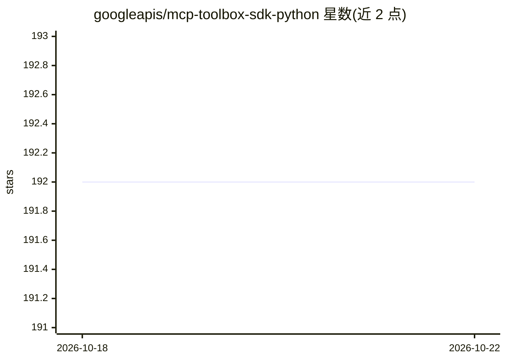

# googleapis/mcp-toolbox-sdk-python

⭐ 192 · Python · Apache-2.0 · 推送 2026-10-22 · [GitHub](https://github.com/googleapis/mcp-toolbox-sdk-python) · [官网](https://mcp-toolbox.dev/documentation/introduction/) · 组织维护

**与 MCP Toolbox 数据库工具集成的 Python SDK**

Google 维护的 Python SDK 集合，用于将 MCP Toolbox（数据库工具服务器）的功能接入 Gen AI 应用：加载 Toolbox 中定义的工具，使其以标准 Python 函数或对象形式在编排框架或自定义代码中使用。仓库含四个包：toolbox-core（框架无关）、toolbox-adk（Google ADK 集成）、toolbox-langchain（LangChain/LangGraph 集成）、toolbox-llamaindex（LlamaIndex 集成），各包可经 pip 安装。使用前提是已运行 MCP Toolbox 服务器。

## 筛选速览

| 维度 | 判定 | 备注 |
|---|---|---|
| AI 角色 | `ai-ecosystem` | LLM/agent 周边工具 |
| 许可风险 | `permissive` | Apache-2.0 |
| 部署形态 | `library` | 以包/库形式分发 |
| 模型依赖 | — | README 未给出锁定关系 |
| 硬件要求 | — | 无带数字的原话,不猜 |
| 安装摩擦 | `low` | 无编译、无系统依赖或容器化 |
| 成熟度 | — | 结构信号不足 |

## 能力要点

- 四个 pip 包分别支持框架无关、Google ADK、LangChain/LangGraph、LlamaIndex 场景
- 将 Toolbox 定义的工具加载为标准 Python 函数或对象
- Apache 2.0 许可

## 适用场景

- 在 LangChain/LlamaIndex 应用中调用数据库工具
- 为自定义 Gen AI 应用加载 MCP Toolbox 工具
- Google ADK 应用接入数据库工具服务

## 场景标签

`数据分析` · 领域:效率与自动化

## 证据(README 行号)

> L10: This repository contains Python SDKs designed to seamlessly integrate the
> L13: applications. These SDKs allow you to load tools defined in Toolbox and use them

## 星数曲线

2026-10-18 192 → 2026-10-22 192（+0）

---
*卡片 v1 · prompt 1.4 · 生成 2026-10-22 · 置信度 high · 依据 README sha `83eea0c1875a` · [字段定义](../../DATASET.md)*
