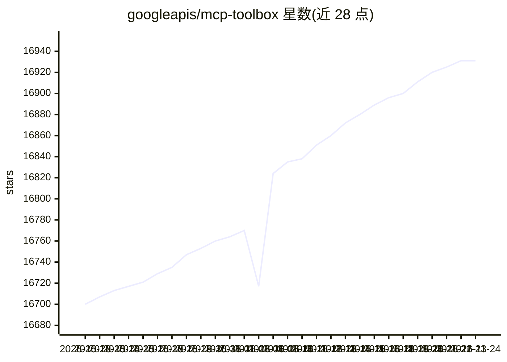

# googleapis/mcp-toolbox

⭐ 16,931 · Go · Apache-2.0 · 推送 2026-11-20 · [GitHub](https://github.com/googleapis/mcp-toolbox) · [官网](https://mcp-toolbox.dev/documentation/introduction/) · 组织维护

**面向 AI agent/IDE 的开源数据库 MCP 服务器**

googleapis 维护的开源 MCP 服务器，将 AI agent、IDE 与应用直接连接到企业数据库。双重用途：其一为预置通用工具（list_tables、execute_sql 等）供 Gemini CLI、Claude Code 等 MCP 客户端即时接入；其二为自定义工具框架，通过 tools.yaml 定义数据源、工具、工具集、提示与资源，支持结构化查询、语义搜索与 NL2SQL。覆盖 Google Cloud 与第三方共数十种数据库，内置连接池、IAM 认证与 OpenTelemetry 可观测性，并提供 Python/JS/Go/Java SDK 集成到 ADK、LangChain 等 agent 框架。

## 筛选速览

| 维度 | 判定 | 备注 |
|---|---|---|
| AI 角色 | `ai-ecosystem` | LLM/agent 周边工具 |
| 许可风险 | `permissive` | Apache-2.0 |
| 部署形态 | `desktop` | 安装包/桌面程序 |
| 模型依赖 | — | README 未给出锁定关系 |
| 硬件要求 | — | 无带数字的原话,不猜 |
| 安装摩擦 | `low` | 无编译、无系统依赖或容器化 |
| 成熟度 | — | 结构信号不足 |

## 动量与使用信号

- 维护:`active` — 距上次 push 1.4 天,年发版 31,167 位贡献者
- 涨星:近 1 天 **+5**(自 20261016 起算)
- 安装:npm 包 `@google/gemini-cli` 月下载 1,647,448
- 平台:— · 协议:MCP

## 能力要点

- 预置通用工具即时连接 MCP 客户端与数据库
- tools.yaml 声明式自定义工具框架（sources/tools/toolsets/prompts/resources）
- 支持 AlloyDB、BigQuery、PostgreSQL、MySQL、Elasticsearch 等数十种数据库
- 提供 Python/JS/Go/Java SDK 与连接池、IAM 认证、OpenTelemetry

## 适用场景

- 让 IDE 或 CLI 中的 AI 助手直接查询与探索数据库
- 为生产环境 agent 构建带受限访问的数据库工具
- 通过自然语言生成数据库感知的代码

## 场景标签

`数据分析` · 领域:效率与自动化

## 证据(README 行号)

> L18: MCP Toolbox for Databases is an open source Model Context Protocol (MCP) server that connects your AI agents, IDEs,
> L24: 2. **Custom Tools Framework (Run-Time):** A robust framework to build specialized, highly secure AI tools for your 

## 星数曲线

2026-10-22 16,700 → 2026-11-24 16,931（+231）

---
*卡片 v1 · prompt 1.4 · 生成 2026-11-22 · 置信度 mid · 依据 README sha `a17dfb357113` · [字段定义](../../DATASET.md)*
