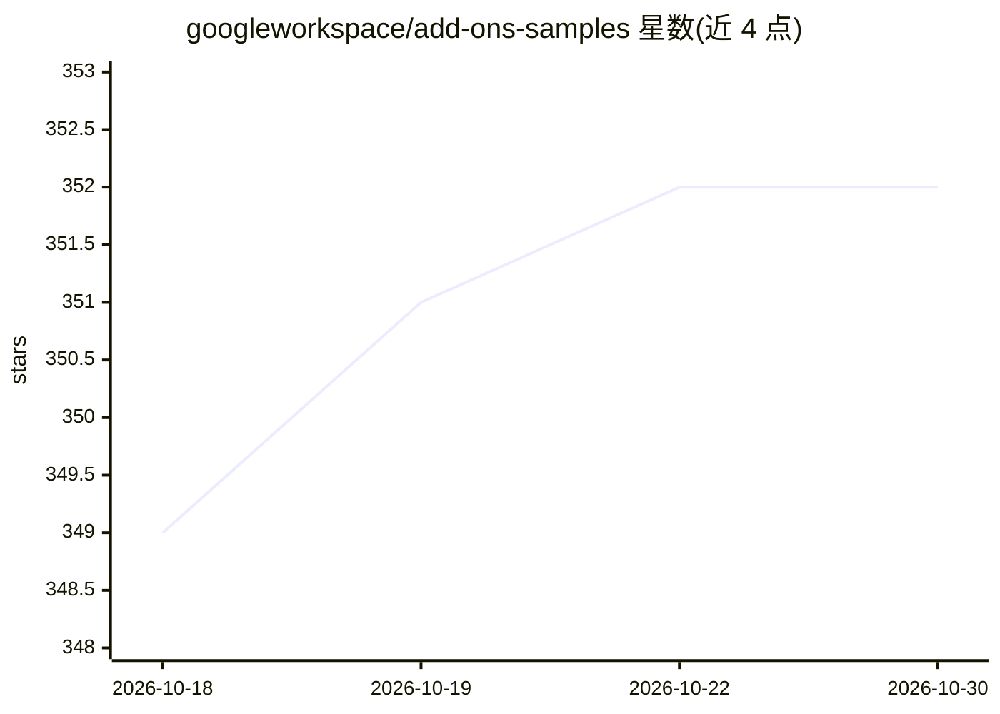

# googleworkspace/add-ons-samples

⭐ 352 · JavaScript · Apache-2.0 · 推送 2026-10-26 · [GitHub](https://github.com/googleworkspace/add-ons-samples) · [官网](https://developers.google.com/workspace/add-ons/overview) · 组织维护

**Google Workspace 插件官方示例代码合集**

Google Workspace 官方维护的插件（Add-ons）示例仓库，覆盖 Gmail、Google 日历、Chat、Docs、Drive 等 Workspace 产品的插件开发示例，每个示例位于独立子目录并附有各自的详细说明。面向需要参考官方示例来学习或构建 Workspace 插件的开发者。仓库不含统一安装入口，具体安装与运行方式需查看各子目录文档。以 Apache 2 许可发布。

## 筛选速览

| 维度 | 判定 | 备注 |
|---|---|---|
| AI 角色 | `ai-ecosystem` | LLM/agent 周边工具 |
| 许可风险 | `permissive` | Apache-2.0 |
| 部署形态 | `None` |  |
| 模型依赖 | — | README 未给出锁定关系 |
| 硬件要求 | — | 无带数字的原话,不猜 |
| 安装摩擦 | `low` | 无编译、无系统依赖或容器化 |
| 成熟度 | — | 结构信号不足 |

## 能力要点

- Google Workspace 各产品插件的示例代码集合
- 每个示例位于独立子目录，附各自详细说明
- 由 Google Workspace 官方组织维护

## 适用场景

- 学习如何为 Gmail/日历/Chat 等开发插件
- 参考官方示例构建自己的 Workspace 插件
- 了解不同 Workspace 产品插件的代码结构

## 场景标签

 · 领域:办公协作/开发者示例

## 证据(README 行号)

> L1: # Google Workspace Add-ons samples
> L5: This repository contains samples Google Workspace Add-ons.

## 星数曲线

2026-10-18 349 → 2026-10-30 352（+3）

---
*卡片 v1 · prompt 1.4 · 生成 2026-10-21 · 置信度 mid · 依据 README sha `fd27f36e9e2c` · [字段定义](../../DATASET.md)*
