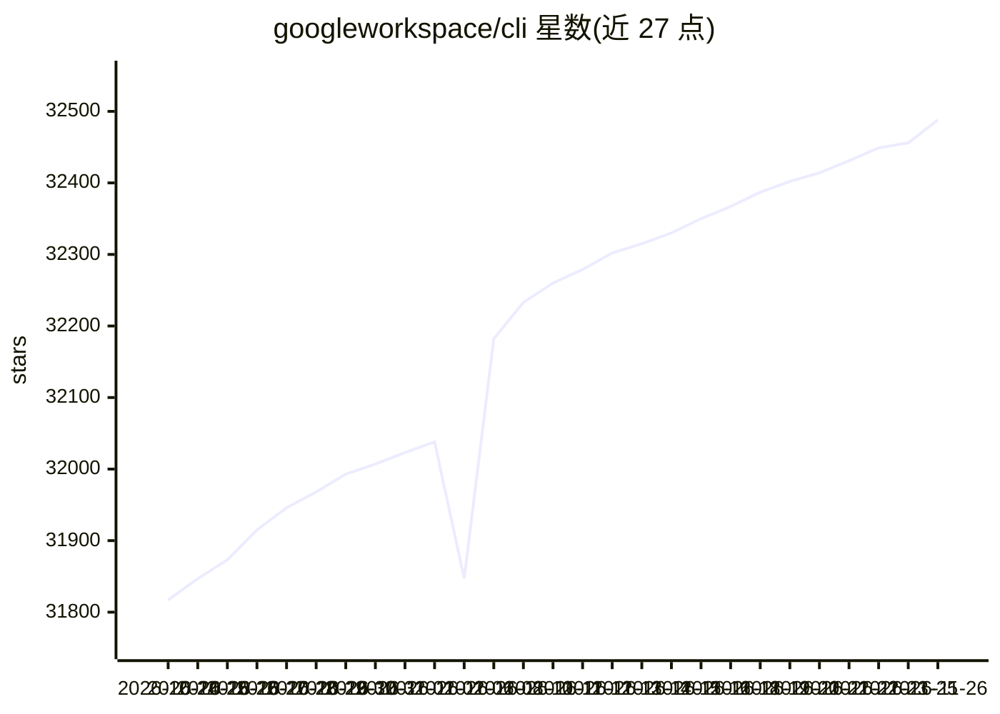

# googleworkspace/cli

⭐ 32,488 · Rust · Apache-2.0 · 推送 2026-11-24 · [GitHub](https://github.com/googleworkspace/cli) · [官网](https://developers.google.com/workspace/guides/workspace-cli) · 组织维护

**面向人类与 AI agent 的 Google Workspace API 统一 CLI**

Rust 编写的社区 CLI `gws`，运行时读取 Google Discovery Service 动态生成全部 Workspace API 命令面，输出结构化 JSON，支持自动分页与 dry-run 预览。提供多种认证流程（gcloud 引导、手动 OAuth、headless/CI 导出、Service Account、预取 token），凭证以 AES-256-GCM 加密存储。附带 100+ 个 agent skills（SKILL.md）与 50 个工作流 recipe，可作为 Gemini CLI 扩展安装，并支持通过 Model Armor 扫描 prompt injection。声明为社区项目，非 Google 官方支持产品，v1.0 前可能有破坏性变更。

## 筛选速览

| 维度 | 判定 | 备注 |
|---|---|---|
| AI 角色 | `ai-ecosystem` | LLM/agent 周边工具 |
| 许可风险 | `permissive` | Apache-2.0 |
| 部署形态 | `library` | 以包/库形式分发 |
| 模型依赖 | — | README 未给出锁定关系 |
| 硬件要求 | — | 无带数字的原话,不猜 |
| 安装摩擦 | `low` | 无编译、无系统依赖或容器化 |
| 成熟度 | `idea` | |

## 动量与使用信号

- 维护:`active` — 距上次 push 11.5 天,年发版 44,43 位贡献者
- 涨星:近 1 天 **+64**(自 20261016 起算)
- 安装:npm 包 `@googleworkspace/cli` 月下载 215,882
- 平台:MACOS / LINUX · 协议:—

## 能力要点

- 运行时读取 Discovery Service，动态覆盖全部 Workspace API 端点
- 内置 100+ agent skills 与 50 个 Gmail/Drive/Docs/Calendar/Sheets recipes
- 多认证流程：gcloud、手动 OAuth、CI 导出、Service Account、预取 token
- 支持 Model Armor 对 API 响应做 prompt injection 扫描

## 适用场景

- 让 LLM agent 通过 CLI 与 skills 管理 Drive/Gmail/Calendar
- 在 CI/headless 环境用导出凭证或 Service Account 调用 Workspace API
- 用 +agenda、+standup-report 等助手命令生成会议与邮件摘要

## 场景标签

 · 领域:开发工具/API 客户端

## 证据(README 行号)

> L3: **One CLI for all of Google Workspace — built for humans and AI agents.**
> L75: **For AI agents** — every response is structured JSON. Pair it with the included agent skills and your LLM can mana
> L196: The repo ships 100+ Agent Skills (`SKILL.md` files) — one for every supported API, plus higher-level helpers for c

## 星数曲线

2026-10-24 31,817 → 2026-11-26 32,488（+671）

---
*卡片 v1 · prompt 1.4 · 生成 2026-11-26 · 置信度 high · 依据 README sha `852ced62d470` · [字段定义](../../DATASET.md)*
