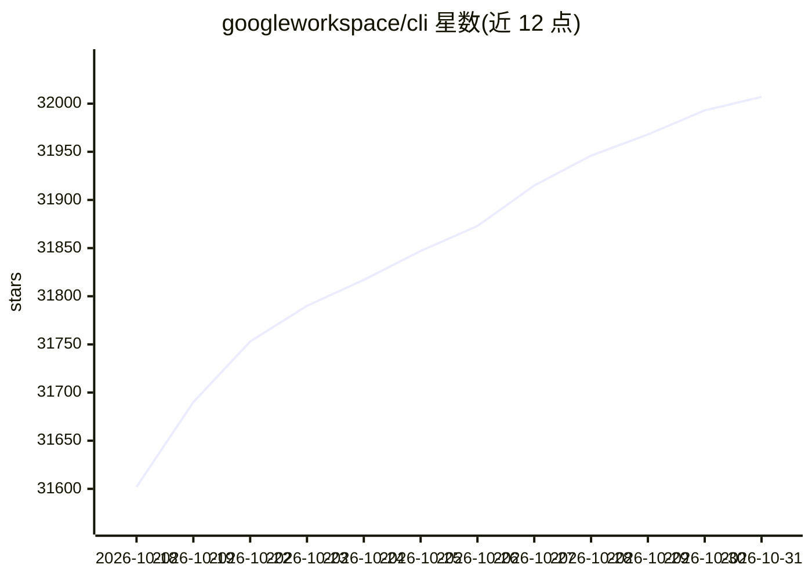

# googleworkspace/cli

⭐ 32,007 · Rust · Apache-2.0 · 推送 2026-10-30 · [GitHub](https://github.com/googleworkspace/cli) · [官网](https://developers.google.com/workspace) · 组织维护

**面向人类与 AI agent 的 Google Workspace 统一命令行工具**

单一 CLI 覆盖 Drive、Gmail、Calendar、Sheets、Docs、Chat、Admin 等 Workspace API：运行时读取 Google Discovery Service 动态生成命令面，新端点自动纳入。输出为结构化 JSON，支持 --dry-run 预览与自动分页；附带 100+ 个 SKILL.md 格式的 agent 技能与 50 个工作流配方，支持 npx skills add 与 OpenClaw 安装，并作为 Gemini CLI 扩展接入。认证覆盖交互式 OAuth、Service Account、预取 token 等多种方式；凭据以 AES-256-GCM 加密存放于系统钥匙串。预编译二进制发布于 GitHub Releases，也可经 npm、cargo、Homebrew、Nix 安装。README 声明非 Google 官方支持产品，v1.0 前可能有破坏性变更。

## 筛选速览

| 维度 | 判定 | 备注 |
|---|---|---|
| AI 角色 | `ai-ecosystem` | LLM/agent 周边工具 |
| 许可风险 | `permissive` | Apache-2.0 |
| 部署形态 | `library` | 以包/库形式分发 |
| 模型依赖 | — | README 未给出锁定关系 |
| 硬件要求 | — | 无带数字的原话,不猜 |
| 安装摩擦 | `low` | 无编译、无系统依赖或容器化 |
| 成熟度 | `idea` | |

## 动量与使用信号

- 维护:`active` — 距上次 push 11.5 天,年发版 44,43 位贡献者
- 涨星:近 1 天 **+64**(自 20261016 起算)
- 安装:npm 包 `@googleworkspace/cli` 月下载 215,882
- 平台:MACOS / LINUX · 协议:—

## 能力要点

- 运行时读取 Discovery Service 动态构建全部命令，无需随 API 更新发版
- 输出结构化 JSON，附带 100+ agent 技能与 50 个 Gmail/Drive/Docs/Calendar/Sheets 配方
- 多种认证工作流：交互式 OAuth、Service Account、预取 token、无头 CI 导出
- 带 + 前缀的手工 helper 命令（+agenda、+send、+triage 等）与 Model Armor 提示注入扫描

## 适用场景

- 让 LLM agent 通过技能直接管理 Google Workspace 邮件、日历与文档
- 在终端用一条命令调用任意 Workspace API 并获得 JSON 输出
- 在无头/CI 环境导出凭据后运行 Workspace 自动化脚本
- 用 Model Armor 模板扫描 API 响应中的提示注入后再交给 agent

## 场景标签

 · 领域:开发者工具/办公自动化

## 证据(README 行号)

> L3: **One CLI for all of Google Workspace — built for humans and AI agents.**
> L190: The repo ships 100+ Agent Skills (`SKILL.md` files) — one for every supported API, plus higher-level helpers for c

## 星数曲线

2026-10-18 31,602 → 2026-10-31 32,007（+405）

---
*卡片 v1 · prompt 1.4 · 生成 2026-10-18 · 置信度 high · 依据 README sha `21031d37a7d0` · [字段定义](../../DATASET.md)*
