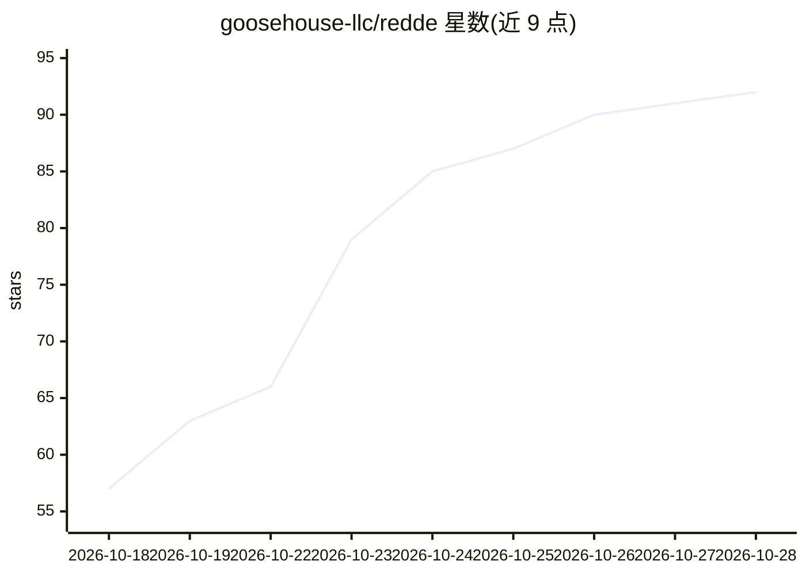

# goosehouse-llc/redde

⭐ 92 · Swift · NOASSERTION · 推送 2026-10-27 · [GitHub](https://github.com/goosehouse-llc/redde) · [官网](https://redde.goosehouse.org) · 组织维护

**iPhone/iPad/CarPlay 客户端：连接自托管 Hermes AI agent 或任意 OpenAI 兼容模型**

iOS/iPadOS/CarPlay 应用，作为开源 Hermes AI agent 的手机端客户端，也可直连任意 OpenAI 兼容模型服务器（llama.cpp、vLLM、Ollama 等）。支持语音优先操作（设备端语音识别、免提、CarPlay/AirPods）、流式推理与工具调用展示、审批卡片、会话/项目/技能/cron/看板管理，以及 Apple Watch 应用。无账号无分析，对话只发往用户配置的服务器，凭据存 iOS Keychain；可选加密推送中继。需 iOS 26+，从源码构建需 Xcode 27 与 XcodeGen。

## 筛选速览

| 维度 | 判定 | 备注 |
|---|---|---|
| AI 角色 | `ai-ecosystem` | LLM/agent 周边工具 |
| 许可风险 | `none` | NOASSERTION |
| 部署形态 | `None` |  |
| 模型依赖 | local-ok | 支持本地模型 |
| 硬件要求 | — | 无带数字的原话,不猜 |
| 安装摩擦 | `medium` | 含编译或系统依赖之一 |
| 成熟度 | — | 结构信号不足 |

## 能力要点

- 连接 Hermes agent 或任意 OpenAI 兼容模型服务器（三种连接方式）
- 设备端语音识别、免提对话、CarPlay 与 AirPods 支持（点头审批）
- 工具调用与审批卡片、sudo/密钥提示，可在通知中应答
- 无账号无分析，凭据存 iOS Keychain，可选端到端加密通知中继

## 适用场景

- 在手机上通过语音或文字操控自托管的 Hermes agent
- 开车时用 CarPlay 免提与 agent 对话并语音审批
- 直连本地 llama.cpp/Ollama/vLLM 服务器与模型对话
- 在 Apple Watch 上口述提问并听取回答

## 场景标签

`语音 Agent` `AI 助手` · 领域:对话与助手

## 证据(README 行号)

> L3: An iPhone, iPad and CarPlay client for Hermes, the
> L4: open-source AI agent you run on your own machine, or for any OpenAI-compatible model server. Talk or
> L75: |**OpenAI-compatible**|llama.cpp, llama-swap, vLLM, Ollama or a hosted provider|Talking straight to a model, with n

## 星数曲线

2026-10-18 57 → 2026-10-28 92（+35）

---
*卡片 v1 · prompt 1.4 · 生成 2026-10-24 · 置信度 high · 依据 README sha `873035b17595` · [字段定义](../../DATASET.md)*
