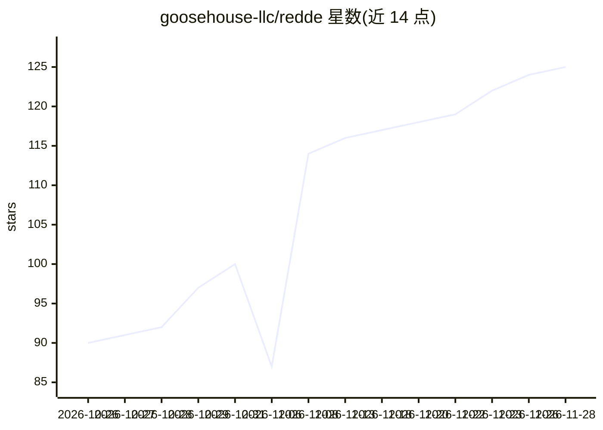

# goosehouse-llc/redde

⭐ 125 · Swift · NOASSERTION · 推送 2026-11-27 · [GitHub](https://github.com/goosehouse-llc/redde) · [官网](https://redde.goosehouse.org) · 组织维护

**iPhone/iPad/CarPlay 上的 Hermes AI 代理客户端，兼容 OpenAI 格式模型服务**

面向自托管 Hermes AI 代理或任意 OpenAI 兼容模型服务的 iOS 客户端，支持 iPhone、iPad、CarPlay 与 Apple Watch。提供语音优先交互（设备端语音识别、免提模式、打断）、流式推理与工具调用审批展示、手机工具（日历/提醒/联系人/照片）代理访问、QR 码/链接快速配置。需 iOS 26+，后端三选一：Hermes Dashboard、Hermes API 或直连 OpenAI 兼容服务。许可证为 FSL-1.1-MIT。

## 筛选速览

| 维度 | 判定 | 备注 |
|---|---|---|
| AI 角色 | `ai-native` | 本体是模型或模型工具 |
| 许可风险 | `none` | NOASSERTION |
| 部署形态 | `None` |  |
| 模型依赖 | local-ok | 支持本地模型 |
| 硬件要求 | — | 无带数字的原话,不猜 |
| 安装摩擦 | `medium` | 含编译或系统依赖之一 |
| 成熟度 | — | 结构信号不足 |

## 能力要点

- 设备端语音识别与免提对话，支持任意识别语言
- 展示流式推理、工具调用与审批卡片，可语音点头批准
- 代理可经授权访问日历、提醒、联系人、照片等手机功能
- QR 码/setup 链接自动填充服务器连接配置

## 适用场景

- 在手机上远程查看和审批家中 Hermes 代理的操作
- 不开账号、不经第三方，直连自己的模型服务器聊天
- 通过 CarPlay 或手表语音与代理交互

## 场景标签

`语音 Agent` `AI 助手` · 领域:对话与助手

## 证据(README 行号)

> L3: An iPhone, iPad and CarPlay client for Hermes, the
> L74: - A backend, reached by one of three connections:
> L80: |**OpenAI-compatible**|llama.cpp, llama-swap, vLLM, Ollama or a hosted provider|Talking straight to a model, with n

## 星数曲线

2026-10-26 90 → 2026-11-28 125（+35）

---
*卡片 v1 · prompt 1.4 · 生成 2026-11-28 · 置信度 high · 依据 README sha `5ac48687339b` · [字段定义](../../DATASET.md)*
