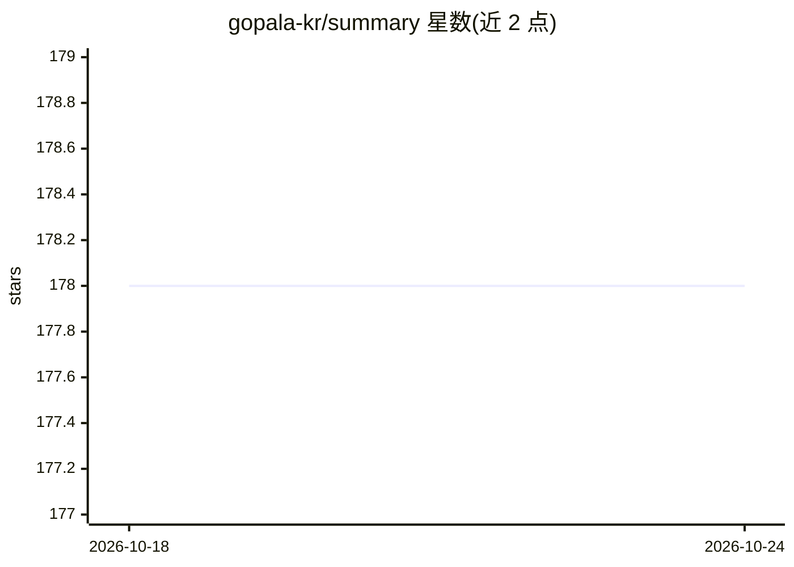

# gopala-kr/summary

⭐ 178 · MIT · 推送 2026-10-20 · [GitHub](https://github.com/gopala-kr/summary) · 个人维护

**个人深度学习论文阅读摘要清单（2017-2019 按周/月组织）**

个人维护的深度学习论文阅读笔记仓库：以 Markdown 列表形式按周（2017 年）和月份（2018-2019 年）记录所读论文的标题，主题覆盖 DL 历史、NLP、计算机视觉、强化学习、GAN、AutoML、机器翻译、机器人等；部分条目带星标、代码链接或 PDF 链接。无安装或运行内容，属于纯文本阅读记录。面向浏览深度学习论文脉络的学习者与研究者。

## 筛选速览

| 维度 | 判定 | 备注 |
|---|---|---|
| AI 角色 | `ai-knowledge` | 知识聚合/清单类 |
| 许可风险 | `permissive` | MIT |
| 部署形态 | `None` |  |
| 模型依赖 | — | README 未给出锁定关系 |
| 硬件要求 | — | 无带数字的原话,不猜 |
| 安装摩擦 | `medium` | 含编译或系统依赖之一 |
| 成熟度 | — | 结构信号不足 |

## 能力要点

- 按周/月时间线组织的论文标题清单（2017-2019）
- 覆盖 NLP、CV、强化学习、GAN、AutoML 等多个主题方向
- 部分条目附星标、代码或 PDF 链接

## 适用场景

- 按时间线浏览 2017-2019 年深度学习论文脉络
- 查找特定方向（如 NAS、机器翻译、联邦学习）的论文线索

## 场景标签

`精选清单` · 领域:学习与行业

## 证据(README 行号)

> L1: summaries of papers on deep learning.
> L3: * [Week-1] 15-Oct-2017 - DL history and basics : DBN, AlexNet, VGGNet, GoogLeNet, ResNet, RNN(speech evolution)

## 星数曲线

2026-10-18 178 → 2026-10-24 178（+0）

---
*卡片 v1 · prompt 1.4 · 生成 2026-10-22 · 置信度 high · 依据 README sha `754ab5b67839` · [字段定义](../../DATASET.md)*
