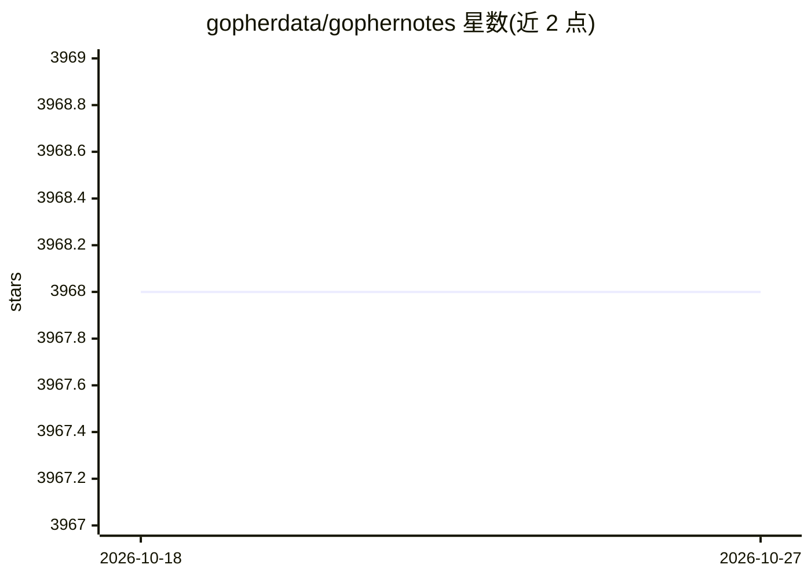

# gopherdata/gophernotes

⭐ 3,968 · Go · MIT · 推送 2026-09-23 · [GitHub](https://github.com/gopherdata/gophernotes) · 组织维护

**在 Jupyter/nteract 中交互式运行 Go 代码的内核**

gophernotes 是一个 Jupyter 内核，让用户在浏览器 notebook 或 nteract 桌面应用中交互式编写与运行 Go 代码，创建含实时代码、公式、可视化和文字的文档。底层使用 gomacro 解释器求值，支持 %cd、%go111module、$ shell 命令等特殊指令。安装方式包括 go install 模块安装、GOPATH 源码手动安装与 Docker 镜像（含预装 gonum/gota/golearn 的数据科学版）。限制：Windows 原生不支持导入第三方包（Go plugin 包限制）、部分解释器边角情形未实现。

## 筛选速览

| 维度 | 判定 | 备注 |
|---|---|---|
| AI 角色 | `ai-ecosystem` | LLM/agent 周边工具 |
| 许可风险 | `permissive` | MIT |
| 部署形态 | `desktop` | 安装包/桌面程序 |
| 模型依赖 | — | README 未给出锁定关系 |
| 硬件要求 | — | 无带数字的原话,不猜 |
| 安装摩擦 | `low` | 无编译、无系统依赖或容器化 |
| 成熟度 | — | 结构信号不足 |

## 能力要点

- 基于 gomacro 解释器在 notebook 中交互式求值 Go 代码
- 支持 Jupyter Notebook 与 nteract 两种前端
- 提供普通版与预装 gonum/gota/golearn 的数据科学版 Docker 镜像
- 支持 %cd、%go111module、$ shell 命令等特殊指令

## 适用场景

- 用 Go 在 Jupyter 中做数据科学探索与可视化
- 创建并分享含实时 Go 代码的交互式文档
- 通过 Docker 快速体验 Go notebook 环境无需本地安装

## 场景标签

 · 领域:开发工具/数据科学

## 证据(README 行号)

> L6: # gophernotes - Use Go in Jupyter notebooks and nteract
> L8: `gophernotes` is a Go kernel for Jupyter notebooks and nteract. It lets you use Go interactively in a browser-based 
> L10: **Acknowledgements** - This project utilizes a Go interpreter called gomacro under the hood to evaluate Go code int

## 星数曲线

2026-10-18 3,968 → 2026-10-27 3,968（+0）

---
*卡片 v1 · prompt 1.4 · 生成 2026-10-20 · 置信度 high · 依据 README sha `c03d5805f6ee` · [字段定义](../../DATASET.md)*
