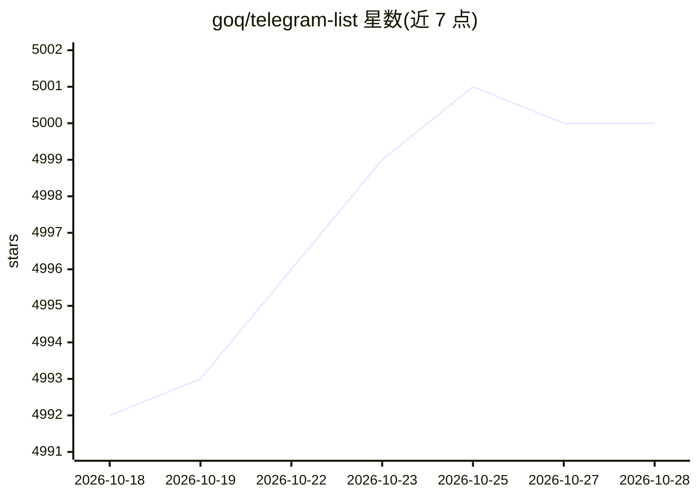

# goq/telegram-list

⭐ 5,000 · 推送 2026-08-30 · [GitHub](https://github.com/goq/telegram-list) · 个人维护

**面向程序员与 IT 从业者的 Telegram 群组、频道与机器人清单**

社区维护的策展清单：收录俄语圈面向程序员、开发者、极客、运维等人群的 Telegram 频道、群聊与机器人，按新闻、编程语言、Data Science、DevOps 等分类组织。条目以链接加一句话描述的形式呈现，用 😵 标记长期未更新的资源；通过 pull request 接受社区补充，并有官方发布频道与讨论群。内容以俄语资源为主，兼有少量英语频道。

## 筛选速览

| 维度 | 判定 | 备注 |
|---|---|---|
| AI 角色 | `ai-knowledge` | 知识聚合/清单类 |
| 许可风险 | `none` | — |
| 部署形态 | `None` |  |
| 模型依赖 | — | README 未给出锁定关系 |
| 硬件要求 | — | 无带数字的原话,不猜 |
| 安装摩擦 | `low` | 无编译、无系统依赖或容器化 |
| 成熟度 | — | 结构信号不足 |

## 能力要点

- 按主题分类组织（新闻、各编程语言、Data Science、DevOps 等）
- 用 😵 标记长期未更新的频道/群组
- 通过 pull request 接受社区提交的新条目
- 设有官方发布频道与讨论群

## 适用场景

- 按编程语言或主题查找相关 Telegram 社区
- 发现俄语 IT 圈的资讯频道与交流群
- 为 Data Science / DevOps 等方向寻找同行交流群

## 场景标签

`精选清单` · 领域:学习与行业

## 证据(README 行号)

> L1: # telegram-list
> L3: Список интересных групп, каналов и ботов телеграма. Чаты Telegram для программистов и разработчиков, гиков, айтишник

## 星数曲线

2026-10-18 4,992 → 2026-10-28 5,000（+8）

---
*卡片 v1 · prompt 1.4 · 生成 2026-10-20 · 置信度 mid · 依据 README sha `e094dc25ba70` · [字段定义](../../DATASET.md)*
