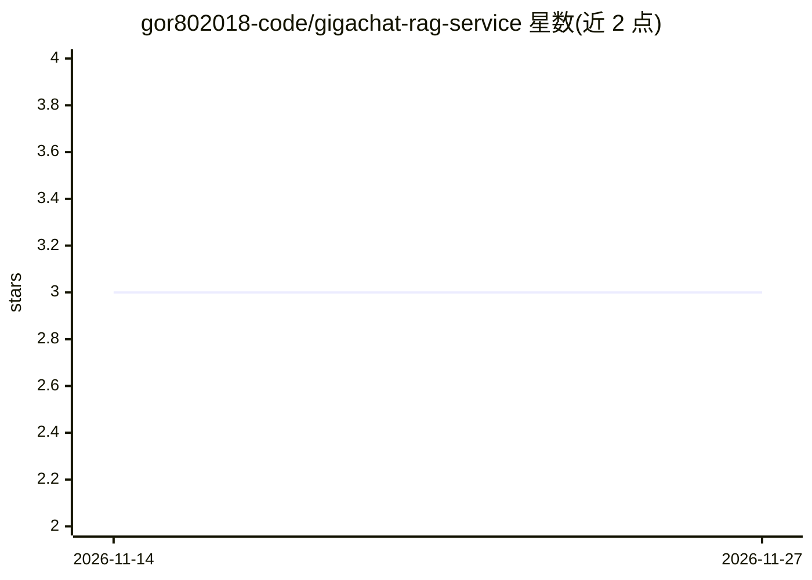

# gor802018-code/gigachat-rag-service

⭐ 3 · Python · MIT · 推送 2026-11-17 · [GitHub](https://github.com/gor802018-code/gigachat-rag-service) · 个人维护

**基于自有文档的 RAG 问答服务：带引用、JWT、Docker 部署**

FastAPI 后端 + Streamlit 前端的检索增强问答服务：上传 PDF/DOCX/TXT/MD 文档后切片、嵌入并写入 FAISS 索引，问答时按用户隔离检索，答案附文件名、页码、片段号与分数等来源引用。默认 LLM 为 GigaChat，可通过环境变量切换 openai/deepseek；含 JWT 认证、PostgreSQL 历史、retriever 分数阈值下的拒答机制、Docker Compose 部署与 160 个 pytest 测试。限制：FAISS 索引驻留进程内存，单 worker 运行；无 CUDA 推理（CPU 版 torch）。

## 筛选速览

| 维度 | 判定 | 备注 |
|---|---|---|
| AI 角色 | `ai-native` | 本体是模型或模型工具 |
| 许可风险 | `permissive` | MIT |
| 部署形态 | `self-host` | docker 或自建部署 |
| 模型依赖 | — | README 未给出锁定关系 |
| 硬件要求 | — | 无带数字的原话,不猜 |
| 安装摩擦 | `low` | 无编译、无系统依赖或容器化 |
| 成熟度 | — | 结构信号不足 |

## 能力要点

- 答案附来源引用（file_name、页码、片段号、score）
- 低于相关阈值的片段被丢弃，无相关内容时不调用 LLM 直接拒答
- LLM 提供商经环境变量切换：gigachat（默认）/openai/deepseek
- JWT 认证，文档与问答历史按 user_id 隔离

## 适用场景

- 对合同、文档等自有资料做带出处的问答
- 需要多用户隔离和登录的文档问答系统
- 用 Docker Compose 一键部署自托管 RAG 服务

## 场景标签

`RAG` `文档问答` · 领域:知识与检索

## 证据(README 行号)

> L7: Production-ready сервис Retrieval-Augmented Generation: загружаете свои документы — задаёте вопросы
> L14: - **Ingestion**: PDF, DOCX, TXT, MD → чанки с перекрытием → эмбеддинги → FAISS.
> L21: - **Смена LLM-провайдера через env**: `gigachat` (по умолчанию), `openai`, `deepseek` — без правок кода.

## 星数曲线

2026-11-14 3 → 2026-11-27 3（+0）

---
*卡片 v1 · prompt 1.4 · 生成 2026-11-22 · 置信度 mid · 依据 README sha `6b91500b4faa` · [字段定义](../../DATASET.md)*
