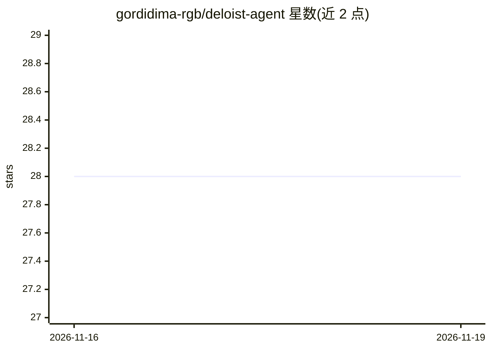

# gordidima-rgb/deloist-agent

⭐ — · [GitHub]() · 个人维护

**Windows 桌面 AI 机器人团队应用：多角色分身、审批与例行任务**

Rust 编写、运行于 Windows 10/11 的桌面应用，托管一支各有角色、模型、文件夹与记忆的机器人团队，可接入 ChatGPT、Claude、Gemini、DeepSeek、本地 Ollama 与 LM Studio 等多种模型。机器人使用自有浏览器执行任务、按 51 种即时通讯规则收发消息、按计划运行例行任务；发送、支付、删除等高风险动作需用户审批卡片确认。语音在本地识别，记忆以 Markdown 文件存储于本机。通过 Deloist-Setup.exe 安装，亦可从源码 cargo build；源码以 PolyForm Noncommercial 许可提供，官方构建含 Deloist 账户与订阅等闭源部分。

## 筛选速览

| 维度 | 判定 | 备注 |
|---|---|---|
| AI 角色 | `ai-native` | 本体是模型或模型工具 |
| 许可风险 | `none` | — |
| 部署形态 | `desktop` | 安装包/桌面程序 |
| 模型依赖 | local-ok | 支持本地模型 |
| 硬件要求 | — | 无带数字的原话,不猜 |
| 安装摩擦 | `medium` | 含编译或系统依赖之一 |
| 成熟度 | — | 结构信号不足 |

## 能力要点

- 每个机器人独立角色/模型/文件夹/记忆，可在同一对话中协作并相互交接任务
- 高风险动作（发送/支付/删除/发布）需审批卡片确认，附决策日志
- 支持云模型、聚合 API、本地 Ollama/LM Studio 及任意 OpenAI 兼容端点
- 本地离线语音识别（模型约 0.6 GB）与 Markdown 记忆文件

## 适用场景

- 在桌面同时运行秘书/分析/研究等多个 AI 分身并分配任务
- 让机器人按计划执行例行任务，重要步骤前向我确认
- 通过 Telegram 等即时通讯让机器人按我设定的规则代为收发消息

## 场景标签

`AI 助手` `多智能体` `浏览器自动化` · 领域:Agent 开发

## 证据(README 行号)

> L27: Deloist is a Windows app that hosts a **team of bots**, not a single assistant. Every bot has its own role,
> L37: - **Any models on one team.** ChatGPT, Claude, Gemini, DeepSeek, GigaChat, local Ollama and LM Studio, free tiers. 

## 星数曲线

2026-11-16 28 → 2026-11-19 28（+0）

---
*卡片 v1 · prompt 1.4 · 生成 2026-11-18 · 置信度 high · 依据 README sha `076cf37c30b4` · [字段定义](../../DATASET.md)*
