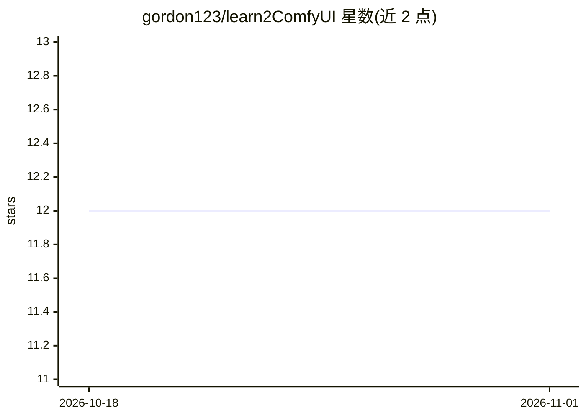

# gordon123/learn2ComfyUI

⭐ 12 · Jupyter Notebook · 推送 2026-09-18 · [GitHub](https://github.com/gordon123/learn2ComfyUI) · 个人维护

**面向新手的 ComfyUI 学习资源与自定义节点策展清单**

个人维护的 ComfyUI 学习资料库：以泰语撰写，整理视频播放列表、Wiki 文章与教学文档，并按用途分类收录自定义节点与工作流链接，覆盖图像编辑与修图、角色一致性、视频与动画、音频、LLM/VLM 标注与提示词生成、模型量化优化（Nunchaku）、杂项工具及外部 Prompt 库等类别。内容为链接索引与简述，不含本仓库自身的安装程序或代码。

## 筛选速览

| 维度 | 判定 | 备注 |
|---|---|---|
| AI 角色 | `ai-knowledge` | 知识聚合/清单类 |
| 许可风险 | `none` | — |
| 部署形态 | `None` |  |
| 模型依赖 | — | README 未给出锁定关系 |
| 硬件要求 | — | 无带数字的原话,不猜 |
| 安装摩擦 | `low` | 无编译、无系统依赖或容器化 |
| 成熟度 | — | 结构信号不足 |

## 能力要点

- 按 8 个功能类别组织的 ComfyUI 自定义节点/工作流链接清单
- 标注了作者认为必须安装的基础节点（ComfyUI-Manager 等）
- 配套 YouTube 播放列表与 Wiki 的 Generative AI 文章
- 收录多个外部 Prompt 库（中/泰语社区）

## 适用场景

- 入门 ComfyUI 时查找该装哪些自定义节点
- 按任务（修图/视频/音频/角色一致性）寻找对应节点与工作流
- 查找图像生成相关的外部 Prompt 库

## 场景标签

`精选清单` `图像生成` · 领域:内容生成

## 证据(README 行号)

> L1: ## ห้องสมุดส่วนตัวเล็ก ๆ สำหรับเรียนรู้ ComfyUI 🎨
> L25: ## ⭐ Custom Node จำเป็น (ต้องลงก่อนเลย)

## 星数曲线

2026-10-18 12 → 2026-11-01 12（+0）

---
*卡片 v1 · prompt 1.4 · 生成 2026-11-01 · 置信度 high · 依据 README sha `75b54a9765b0` · [字段定义](../../DATASET.md)*
