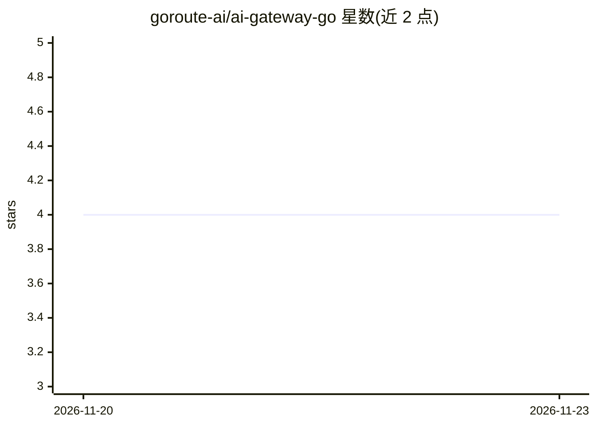

# goroute-ai/ai-gateway-go

⭐ 4 · Go · Apache-2.0 · 推送 2026-11-22 · [GitHub](https://github.com/goroute-ai/ai-gateway-go) · [官网](https://goroute-ai.github.io) · 组织维护

**为 AI 应用提供统一 API 接入多家模型服务商的 Go 网关**

用纯 Go 实现的 AI 网关、MCP Hub 与 Agent 路由器：客户端通过 OpenAI 兼容 API 调用 30 多家托管与本地模型服务商，网关侧提供虚拟模型别名路由、7 种负载均衡策略、分布式 Redis 限流、三态熔断与跨服务商故障转移、流中断续传，以及 64 位整数微美元计费的 FinOps 成本核算。内嵌 Operator Web UI 与流式对话 Playground。安装方式含 Go SDK 嵌入、Shell 一行安装静态二进制、Docker 镜像、Docker Compose 与 Helm/Kubernetes 部署；运行依赖 PostgreSQL 与 Redis（Compose 路径）。

## 筛选速览

| 维度 | 判定 | 备注 |
|---|---|---|
| AI 角色 | `ai-ecosystem` | LLM/agent 周边工具 |
| 许可风险 | `permissive` | Apache-2.0 |
| 部署形态 | `desktop` | 安装包/桌面程序 |
| 模型依赖 | — | README 未给出锁定关系 |
| 硬件要求 | — | 无带数字的原话,不猜 |
| 安装摩擦 | `low` | 无编译、无系统依赖或容器化 |
| 成熟度 | — | 结构信号不足 |

## 能力要点

- 通过统一 OpenAI 兼容 API 接入 30+ 托管与本地模型服务商
- 7 种可插拔负载均衡策略与虚拟模型别名预路由（heuristic/semantic/quality/adaptive）
- Redis Lua 原子脚本实现多租户多维度限流与预算控制
- 64 位整数微美元计费与预检预算拦截（HTTP 402）

## 适用场景

- 为微服务统一管理多个模型服务商的 API 密钥与调用
- 多租户场景下按组织/团队/虚拟密钥做配额与预算控制
- 在服务商限流或故障时自动重试与跨服务商切换
- 部署到 Kubernetes 并通过 Helm 管理网关

## 场景标签

`模型网关` · 领域:Agent 开发

## 证据(README 行号)

> L5: *The ultra-fast, lightweight AI Gateway, MCP Hub, and Agent-to-Agent Router in 100% Pure Go with Embedded Operator W
> L21: **GoRoute AI Gateway** is a fast, lightweight enterprise control plane and high-throughput data plane for AI applic

## 星数曲线

2026-11-20 4 → 2026-11-23 4（+0）

---
*卡片 v1 · prompt 1.4 · 生成 2026-11-21 · 置信度 high · 依据 README sha `9fcd13d780fc` · [字段定义](../../DATASET.md)*
