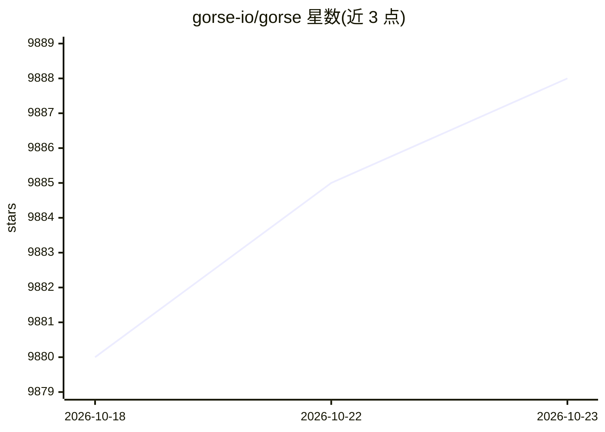

# gorse-io/gorse

⭐ 9,888 · Go · Apache-2.0 · 推送 2026-10-18 · [GitHub](https://github.com/gorse-io/gorse) · [官网](https://gorse.io) · 组织维护

**Go 编写的开源推荐系统引擎：导入数据自动训练模型生成推荐**

用 Go 编写的通用开源推荐系统引擎，面向需要快速接入推荐能力的在线服务开发者。导入物品、用户与交互数据后，系统自动训练模型并为每个用户生成推荐。支持多来源推荐（最新、用户间、物品间、协同过滤）、经 embedding 支持多模态内容、经典推荐器与 reranker/Decision API。提供 GUI 仪表盘与 RESTful API；采用单节点训练、分布式预测架构，master 节点训练模型，server 节点提供实时推荐，worker 节点做离线推荐。数据可存储于 MySQL/MongoDB/Postgres，中间结果可缓存于 Redis。

## 筛选速览

| 维度 | 判定 | 备注 |
|---|---|---|
| AI 角色 | `ai-native` | 本体是模型或模型工具 |
| 许可风险 | `permissive` | Apache-2.0 |
| 部署形态 | `self-host` | docker 或自建部署 |
| 模型依赖 | — | README 未给出锁定关系 |
| 硬件要求 | — | 无带数字的原话,不猜 |
| 安装摩擦 | `low` | 无编译、无系统依赖或容器化 |
| 成熟度 | — | 结构信号不足 |

## 能力要点

- 导入数据后自动训练模型并生成个性化推荐
- 多模态内容（文本/图像/视频）经 embedding 支持
- 提供 GUI 仪表盘：推荐流水线编辑、系统监控、数据管理
- 单节点训练 + 分布式预测架构（master/server/worker 节点）

## 适用场景

- 为在线服务快速搭建个性化推荐能力
- 管理推荐流水线并监控推荐系统运行状态
- 通过 RESTful API 获取实时推荐结果

## 场景标签

`推荐系统` · 领域:学习与行业

## 证据(README 行号)

> L9: Gorse is an AI powered open-source recommender system written in Go. Gorse aims to be a universal open-source recomm
> L13: - **AI-powered:** Support classical recommenders, reranker APIs, and Decision APIs.

## 星数曲线

2026-10-18 9,880 → 2026-10-23 9,888（+8）

---
*卡片 v1 · prompt 1.4 · 生成 2026-10-20 · 置信度 high · 依据 README sha `d7b1929fe327` · [字段定义](../../DATASET.md)*
