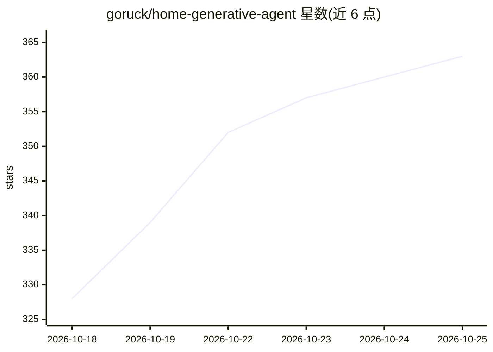

# goruck/home-generative-agent

⭐ 363 · Python · MIT · 推送 2026-10-24 · [GitHub](https://github.com/goruck/home-generative-agent) · [官网](https://community.home-assistant.io/t/a-generative-agent-integration-based-on-langchain-and-langgraph/864923) · 个人维护

**面向 Home Assistant 的生成式 AI agent 集成，用自然语言控制智能家居**

一个 Home Assistant 集成，把生成式 AI agent 引入智能家居：用户用自然语言控制 HA 实体、让 agent 编写并注册自动化 YAML、分析摄像头画面（含人脸识别）、进行长期语义记忆检索（pgvector）。Sentinel 异常引擎以确定性规则监控安全与安全问题（未锁门锁、陌生人、新设备入网等），LLM 仅建议不执行。模型可选用 OpenAI/Gemini/Anthropic 云端或 Ollama 等本地部署，数据可不离开家庭网络。另有内置 STT/TTS（Whisper API 或本地 Speaches）。需 HA 2026.8.0+、HACS 安装、PostgreSQL+pgvector。

## 筛选速览

| 维度 | 判定 | 备注 |
|---|---|---|
| AI 角色 | `ai-native` | 本体是模型或模型工具 |
| 许可风险 | `permissive` | MIT |
| 部署形态 | `None` |  |
| 模型依赖 | local-ok | 支持本地模型 |
| 硬件要求 | — | 无带数字的原话,不猜 |
| 安装摩擦 | `low` | 无编译、无系统依赖或容器化 |
| 成熟度 | — | 结构信号不足 |

## 能力要点

- 自然语言控制实体并让 agent 编写注册 HA 自动化
- Sentinel 确定性异常/安全审计规则（LLM 只建议不执行）
- pgvector 长期语义记忆，支持跨对话记忆偏好
- 支持云端（OpenAI/Gemini/Anthropic）或本地（Ollama/OpenAI 兼容服务器）模型

## 适用场景

- 用对话方式控制家里的灯、开关、摄像头等设备
- 口述需求让 AI 直接生成并注册自动化
- 让 agent 分析摄像头画面并推送主动异常告警
- 本地部署模型，语音与数据全部留在家庭网络内

## 场景标签

`语音 Agent` `人脸识别` · 领域:对话与助手

## 证据(README 行号)

> L13: A Home Assistant integration that brings a generative AI agent into your smart home. Talk to your home, create auto
> L21: Most AI conversation integrations are prompt passthroughs: they forward your words to an LLM and read back the answ

## 星数曲线

2026-10-18 328 → 2026-10-25 363（+35）

---
*卡片 v1 · prompt 1.4 · 生成 2026-10-21 · 置信度 high · 依据 README sha `b7110f4e489f` · [字段定义](../../DATASET.md)*
